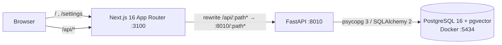
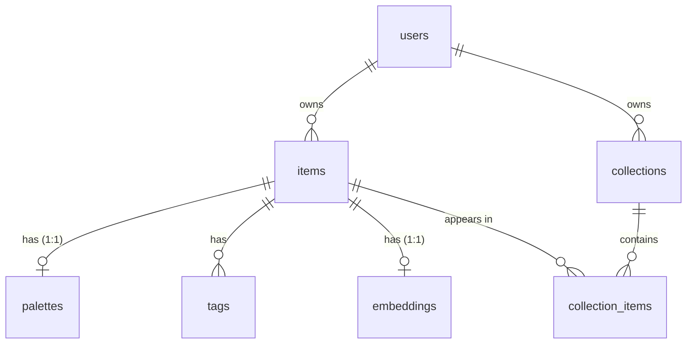

# Thread

A personal visual library for fashion: upload outfits, garments and fabric swatches, and Thread
extracts their palette, tags style and textile craft (including Indian traditions such as ikat,
bandhani and chikankari) and finds similar pieces in your own library.

> **Status: Milestone 4 (Colour palettes) complete.** You can upload images (drag and drop,
> file picker or phone camera), browse them in a gallery, edit and delete them, and every upload
> gets a real colour palette — dominant colours with hex/RGB, human names (including Indian
> colour names such as haldi yellow and sindoor red), percentages, a heuristic harmony label and
> a downloadable palette card. Fashion tags and similarity search arrive in Milestones 5–6; no
> results are shown or invented before then. This README documents only what exists today.

## Architecture (current)



The browser only talks to the Next.js origin. `/api/*` is proxied to FastAPI, so there is no CORS
configuration and, later, private images can stay behind the API.

## Repository layout

```
backend/            FastAPI app (Python 3.11)
  app/api/          routes, dependencies (current user), structured error handlers
  app/color/        LAB maths, palette extraction, naming, harmony, PNG card (+ data/ name lists)
  app/core/         settings (THREAD_ env prefix) and logging
  app/db/           declarative base, engine/session, Alembic helpers
  app/models/       SQLAlchemy 2 models (users, items, palettes, tags, embeddings, collections)
  app/repositories/ owner-scoped data access
  app/schemas/      Pydantic request/response models
  app/services/     image validation, upload/delete use-cases, palette extraction for items
  app/storage/      storage interface (base.py) and local filesystem backend (local.py)
  alembic.ini       Alembic config (no credentials; URL comes from THREAD_DATABASE_URL)
  tests/            pytest suite
frontend/           Next.js App Router + TypeScript (strict) + Tailwind 4
  src/app/          routes: / (landing), /upload, /gallery, /items/[id], /settings (system status)
  src/components/   design-system primitives (Button, StatusBadge, header)
  src/features/     feature modules (landing hero, system status)
  src/lib, services, types   API client, typed API calls, API types
  e2e/              Playwright tests
database/init/      first-run shell script for the Postgres container (creates thread_test)
database/migrations/  Alembic env.py and versioned migrations
docker-compose.yml  PostgreSQL 16 with pgvector
.env.example        all configuration, placeholders only
```

## Prerequisites

| Tool | Version used | Notes |
|---|---|---|
| Docker Desktop | 29.x, Compose v2+ | must be **running** |
| uv | 0.11+ | installs Python 3.11 and the virtualenv |
| Node.js | 24.x (npm 11) | |

## Setup

All commands are run from the repository root unless a `cd` is shown.

**1. Configure environment**

```bash
cp .env.example .env
```

Replace `change-me-local-only` with a local password (it appears three times; keep them equal).
`.env` is git-ignored.

**2. Start PostgreSQL**

```bash
docker compose up -d --wait
```

The first start creates both the `thread` (development) and `thread_test` (automated tests)
databases.

**3. Backend**

```bash
cd backend
uv python install 3.11
uv venv --python 3.11 .venv
uv pip install --python .venv -r requirements-dev.txt
.venv/Scripts/alembic upgrade head
.venv/Scripts/python -m uvicorn app.main:app --reload --host 127.0.0.1 --port 8010
```

(On macOS/Linux use `.venv/bin/...`.) API docs: <http://127.0.0.1:8010/docs>.
`alembic upgrade head` creates the pgvector extension and every table; rerunning it is a no-op.
On startup the API creates the development user (see [Ownership](#ownership-and-the-development-user)).

**4. Frontend** (second terminal)

```bash
cd frontend
npm install
npm run dev
```

Open <http://127.0.0.1:3100>. The **System** page shows live API, PostgreSQL and pgvector status.

## Configuration

| Variable | Used by | Purpose |
|---|---|---|
| `POSTGRES_USER`, `POSTGRES_PASSWORD`, `POSTGRES_DB`, `POSTGRES_PORT` | Docker Compose | database container (host port defaults to 5434) |
| `THREAD_DATABASE_URL` | backend | SQLAlchemy URL, `postgresql+psycopg://…/thread` |
| `THREAD_TEST_DATABASE_URL` | backend tests | must point at `thread_test`, never the dev database |
| `THREAD_APP_ENV`, `THREAD_LOG_LEVEL` | backend | `development` / `test` / `production`; log level |
| `THREAD_DEV_USER_ID`, `THREAD_DEV_USER_NAME` | backend | optional; the local development owner (defaults are built in) |
| `THREAD_STORAGE_DIR` | backend | where uploaded files are stored (default `storage/`) |
| `THREAD_MAX_UPLOAD_BYTES`, `THREAD_MAX_IMAGE_SIDE`, `THREAD_MIN_IMAGE_SIDE`, `THREAD_MAX_IMAGE_PIXELS`, `THREAD_THUMBNAIL_SIDE` | backend (+ proxy limit) | upload limits; defaults 15 MB, 8000 px, 64 px, 40 MP, 640 px |
| `THREAD_PALETTE_SIZE` | backend | colours to extract per image, 1–12 (default 6) |
| `THREAD_API_URL` | frontend (server side) | where the `/api` proxy forwards; default `http://127.0.0.1:8010` |

Backend settings are read **only** with the `THREAD_` prefix. Machine-wide variables from other
projects (for example a global `DATABASE_URL`) are ignored; a regression test enforces this.
The frontend loads the same root `.env` from `next.config.ts`.

## Database schema



| Table | Key points |
|---|---|
| `users` | One seeded development user for the MVP. |
| `items` | Storage keys (never filesystem paths), SHA-256 `content_hash` unique per user (duplicate detection), `processing_status` (queued / processing / completed / partially_completed / failed), user-safe `processing_error`, per-stage `stage_status` JSONB, `attempts`. |
| `palettes` | `colors` JSONB array of `{hex, name, percentage, lab}`; `color_families text[]` with a GIN index for fast colour filters; heuristic `harmony`. |
| `tags` | AI predictions and user corrections are **separate rows** (`source` = `ai` / `user`, `user_action` = `add` / `remove`). Re-analysis rewrites only AI rows, so corrections survive. `confidence` is a raw model score in [0, 1], not a calibrated probability. A CHECK constraint keeps the two kinds of row consistent. |
| `embeddings` | `vector(512)` (OpenCLIP ViT-B/32) with an HNSW index using `vector_cosine_ops`. The dimension is frozen in the migration; the worker will verify the model's real output size before writing. |
| `collections` | Names unique per user, case-insensitively (`lower(name)` unique index). |
| `collection_items` | Stores `user_id` so two **composite foreign keys** — `(collection_id, user_id)` and `(item_id, user_id)` — make it impossible, at the database level, to put one user's item in another user's collection. |

Closed vocabularies use `VARCHAR` + `CHECK` constraints rather than native Postgres enums, so
adding a value later is a simple constraint swap. Deleting an item cascades to its palette, tags,
embedding and collection memberships; deleting a collection never deletes items.

### Migrations

```bash
cd backend
.venv/Scripts/alembic upgrade head        # apply
.venv/Scripts/alembic current             # applied revision
.venv/Scripts/alembic downgrade -1        # step back
.venv/Scripts/alembic revision --autogenerate -m "describe change"   # after editing models
```

Autogenerated migrations are always reviewed by hand. A test asserts the models and migrations
never drift apart. The migration creates the `vector` extension, which needs a role allowed to
create extensions (the Docker development role is a superuser; managed Postgres services usually
require enabling pgvector in their console).

### Ownership and the development user

Every repository is constructed with the current user's id and filters every query by it; another
user's rows behave exactly like missing rows (404, never 403, so ids cannot be probed).
For the local MVP, `get_current_user_id` returns a fixed development user
(`THREAD_DEV_USER_ID`, created on startup). **This is not authentication**: the dependency refuses
to run when `THREAD_APP_ENV=production`, so real authentication must be added before any
deployment.

## Uploads and storage

### API

| Method & path | Purpose |
|---|---|
| `POST /items` | Multipart upload: `file` (required), `type` (`outfit`/`garment`/`fabric`/`accessory`/`other`, default `other`). Returns **201** with the item. |
| `GET /items?type=&limit=&offset=` | Your items, newest first, with `total` for paging. |
| `GET /items/{id}` | One item. |
| `PATCH /items/{id}` | Change `type`, `notes` (≤ 5000 chars) or `source_url` (http/https only). `null` clears notes/URL. |
| `DELETE /items/{id}` | **204**; removes the record and its files. |
| `GET /items/{id}/image?variant=original\|thumbnail` | The stored image, after an ownership check. |

Errors use one JSON shape, `{"error": {"code", "message", "details"}}`:

| Status | `code` | When |
|---|---|---|
| 409 | `conflict` | Same file already in your library; `details.existing_item_id` points at it |
| 413 | `too_large` | Larger than `THREAD_MAX_UPLOAD_BYTES` (15 MB) |
| 415 | `unsupported_format` | A real image, but not JPEG, PNG or WebP (e.g. GIF, BMP, TIFF) |
| 422 | `invalid_image` / `bad_dimensions` / `validation_error` | Not an image, damaged/truncated, outside the size limits, or a bad field |

### What happens to an upload

1. The body is read in chunks and refused as soon as it exceeds the size limit.
2. The **bytes** are inspected with Pillow — the filename and the browser's Content-Type are
   ignored. Only JPEG, PNG and WebP pass.
3. Dimensions are checked from the header **before** any pixels are decoded (max 8000 px per
   side, min 64 px, max 40 MP), which stops decompression bombs; then the image is fully decoded
   to catch truncated or corrupt files.
4. A SHA-256 of the uploaded bytes detects duplicates per user.
5. The camera's EXIF orientation is applied, then the image is re-encoded **without EXIF or other
   metadata** (photos can carry GPS location). The ICC colour profile is kept so colours stay
   accurate for palette extraction. A 640 px WebP thumbnail is generated.
6. Files are written, then the database row is committed (`processing_status = queued`).

**Consistency.** If writing a file or the database insert fails, every file written for that
upload is deleted again, so a row never points at a missing file. Deleting commits the row
removal first, then removes files. The worst case after a crash is an unreferenced file on disk,
never a broken row.

### Storage

Files live under `THREAD_STORAGE_DIR` (default `storage/` at the repo root, git-ignored), outside
anything the frontend serves publicly. Keys are generated by the server —
`users/<user-id>/items/<item-id>/original.<ext>` and `.../thumbnail.webp` — never derived from user
filenames. The local backend validates every key against a strict pattern, refuses anything that
resolves outside the root (path traversal), and opens files in exclusive-create mode so nothing is
overwritten. Images are only reachable through `GET /items/{id}/image`, which checks ownership and
accepts only the two named variants; responses carry `Cache-Control: private`,
`X-Content-Type-Options: nosniff` and a restrictive `Content-Security-Policy`.

To add S3 or Cloudinary later, implement the `Storage` protocol in `app/storage/base.py`
(`save`, `read`, `delete`, `exists`) and return it from `get_storage` in `app/api/deps.py`.

### Proxy body size

The Next.js `/api` proxy buffers request bodies and truncates them at 10 MB by default, which
breaks larger uploads. `next.config.ts` raises `experimental.proxyClientMaxBodySize` to twice
`THREAD_MAX_UPLOAD_BYTES`, so slightly-too-large files still reach FastAPI and get a proper 413.
The upload page also rejects files over 15 MB before sending them.

## Colour palettes

Every upload gets a palette right after it is safely stored (a quick in-process step, typically
well under a second; it will become a stage of the background worker in a later milestone). If
extraction fails the upload still succeeds, the item records `stage_status.palette = "failed"`
with a readable `processing_error`, and **no palette is shown** — colours are never guessed.

| Method & path | Purpose |
|---|---|
| `POST /items/{id}/palette?colors=1..12` | (Re-)extract from the stored image; replaces the earlier palette (upsert). 422 `palette_failed` on failure — a palette extracted earlier is kept. |
| `GET /items/{id}/palette.png` | 1200×675 PNG palette card (download). 404 if there is no palette. |

Items include `palette` (`colors[]` with `hex`, `rgb`, `name`, `family`, `percentage`; `harmony`;
`source`), `stage_status` and `palette_card_url`.

### How LAB colour clustering works

1. **Downscale** to at most 256 px with *nearest-neighbour* sampling. Averaging filters would
   invent blended in-between colours along edges, which would appear as fake swatches.
2. **Choose pixels.** Transparent pixels (alpha < 128) are ignored. For photos (not fabric
   swatches) a cheap backdrop test runs: if ≥ 85% of the border ring is one colour (CIEDE2000 < 8
   from its median), pixels clearly different from it (ΔE ≥ 12) are the subject. The mask is only
   used when the subject covers 5–95% of the image; otherwise the whole image is used. The API
   reports this as `source: "masked"` or `"original"`. (Model-based background removal is planned
   for a later milestone.)
3. **Convert sRGB → CIELAB** (D65). In LAB, equal distances look roughly equally different, so
   clusters group colours the way people see them. Up to 20 000 pixels are sampled with a fixed seed.
4. **K-means** (scikit-learn, k = `THREAD_PALETTE_SIZE`, default 6, fixed `random_state`), capped
   at the number of distinct colours so tiny or flat images work.
5. **Merge** clusters closer than CIEDE2000 6 (one colour, not two), and **drop slivers** under 1%
   (edge noise, specks).
6. **Percentages** from cluster sizes, rounded with the largest-remainder method so they sum to
   exactly 100.0.
7. **Convert each LAB centroid back to sRGB** (clipped to the displayable gamut, rounded). The hex,
   RGB and stored LAB all describe that final sRGB colour, so the swatch on screen and the hex a
   user copies are identical.

Results are deterministic: the same image always gives the same palette.

### Names, families and harmony

- **Names** are the nearest reference colour by CIEDE2000 among the
  [xkcd colour survey](https://xkcd.com/color/rgb.txt) (949 names, CC0, stored in
  `backend/app/color/data/xkcd_colors.json`) and a curated Indian vocabulary
  (`indian_colors.json`: haldi yellow, sindoor red, gulabi pink, mehendi green, neel indigo, rani
  pink, firozi turquoise …). The Indian hex values are representative shades chosen for this
  project, not a formal standard. Ties go to the first entry, so naming is deterministic.
  Naming lives in its own module (`naming.py`) so it can be improved without touching extraction.
- **Families** (red, orange, yellow, green, teal, blue, purple, pink, brown, beige, white, grey,
  black) come from LCh lightness/chroma/hue ranges calibrated against reference colours, and are
  stored in `palettes.color_families` (GIN-indexed) for colour filtering later.
- **Harmony is a heuristic**, labelled as such in the UI. Using hues of clearly coloured swatches
  (chroma ≥ 12, ≥ 5% share) in perceptual LCh space: *neutral* (none), *monochromatic* (within
  30°), *analogous* (within 75°), *complementary* (two tight groups 150–210° apart), else *mixed*.
  Note LCh is not the painter's RYB wheel: e.g. orange and a saturated royal blue are not opposite
  in LCh, so that pair is labelled *mixed*.

### Limitations

Palettes describe the **photo**, not the fabric: lighting colour, camera white balance, shadows,
highlights, sheen and JPEG compression all shift colours (a re-saved JPEG can move a hex by a unit
or two). Percentages are shares of the analysed pixels, so a photo's background counts unless it
is a plain backdrop the mask can detect. Busy backgrounds are not removed yet. Treat the output as
a faithful summary of the image, not a lab measurement of the garment.

## Health check

`GET /health` (or `/api/health` through the frontend) returns:

```json
{"status":"ok","app":"Thread API","version":"0.1.0","environment":"development",
 "database":{"status":"ok","server_version":"16.15","pgvector_available":true,"latency_ms":7.2,
             "schema_revision":"b987c40bd0a0","schema_head":"b987c40bd0a0","schema_up_to_date":true}}
```

It returns **503** with `"status":"degraded"` if PostgreSQL is down (`"database":{"status":"unavailable",…}`)
or if migrations are behind the code (`"schema_up_to_date": false`). Driver error messages and connection strings are never
returned or logged; the log records only the error class.

## Tests and checks

```bash
# backend (from backend/)
.venv/Scripts/ruff check .
.venv/Scripts/ruff format --check .
.venv/Scripts/python -m pytest -v

# frontend (from frontend/)
npm run lint
npm run typecheck
npm test                       # Vitest unit/component tests
npx playwright install chromium   # once
npm run test:e2e               # Playwright; needs Docker Postgres running. Reuses the API on :8010
                               # (or starts it) and always builds + starts a production frontend on
                               # :3101 (next dev was too slow under parallel browsers and made tests
                               # flaky). Tests generate unique images in memory and delete what they create.
npm run build
```

Run Ruff on migrations too: `.venv/Scripts/ruff check . ../database/migrations`.

Database tests (`-m db`) never touch the development database. They connect to `thread_test` only
to create **disposable databases with random names**, migrate them with the real Alembic
migrations, and drop them afterwards. Each test runs inside a transaction that is rolled back.
They are skipped with a clear reason if Postgres is not reachable.

## Troubleshooting

- **`port is already allocated` on `docker compose up`**: another container uses the port. Set a
  free `POSTGRES_PORT` in `.env` and update the port in both `THREAD_*DATABASE_URL` values.
- **Ports 8010 / 3100 busy**: these were chosen because 8000 and 3000 are commonly used by other
  local projects. Change the uvicorn `--port`, `THREAD_API_URL`, and the `dev` script together.
- **`/health` reports the database unavailable**: check `docker compose ps` shows `thread-db` as
  healthy, and that the password in `THREAD_DATABASE_URL` matches `POSTGRES_PASSWORD`.
- **Password changed after first start**: Postgres keeps the original password in the volume.
  Reset (deletes local data): `docker compose down -v` then `docker compose up -d --wait`.
- **`/health` says migrations are pending** (System page shows "Pending"): run
  `.venv/Scripts/alembic upgrade head` from `backend/`, then restart the API so it creates the
  development user.
- **`permission denied to create extension "vector"`**: the database role cannot create
  extensions. Use the Docker Compose database, or enable pgvector as an administrator.
- **`ModuleNotFoundError: asyncpg`** or another project's database name: a generic variable is
  leaking in. Thread only reads `THREAD_*` variables; make sure your `.env` uses those names.

## Roadmap

Milestones 5–8: palette extraction, OpenCLIP
embeddings and tags, pgvector similarity, gallery and collections, end-to-end quality and full
documentation.
