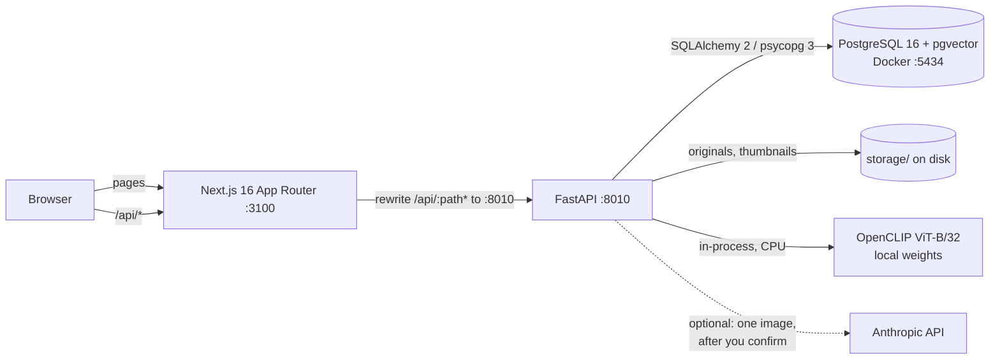
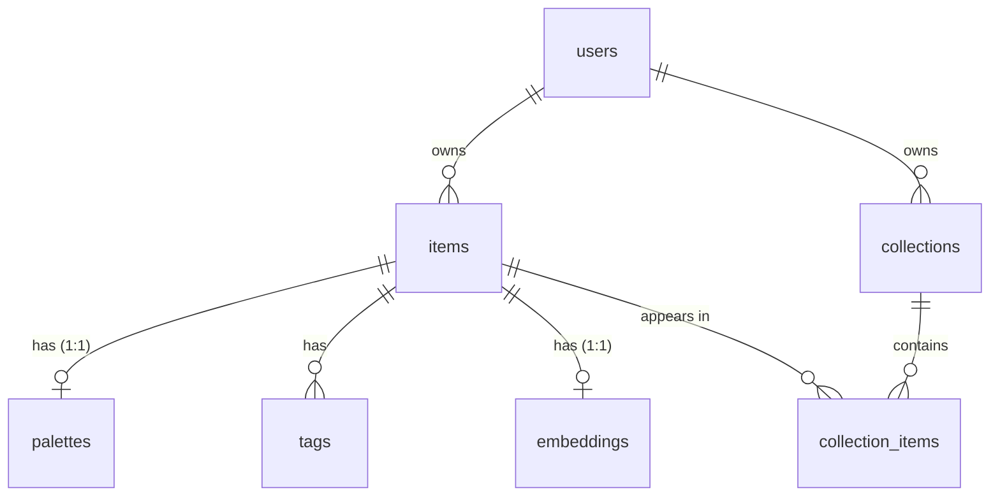

# Thread

A personal visual library for fashion: upload outfits, garments and fabric swatches, and Thread
extracts their palette, tags style and textile craft (including Indian traditions such as ikat,
bandhani and chikankari) and finds similar pieces in your own library.

> **Status: MVP complete (Milestone 8).** Everything below exists and is tested; this README
> documents only what exists today. Tag and deep-analysis accuracy have not been measured (see
> [Known limitations](#known-limitations)). For an interview-level walkthrough of the
> architecture and algorithms, see [docs/architecture.md](docs/architecture.md).

## Features

- **Upload** from desktop (drag and drop, file picker) or phone (camera), with live progress;
  files are validated by their bytes, not their names, and duplicates point at the saved copy.
- **Honest processing status** per piece: awaiting analysis, analysing, partly analysed,
  analysed or failed. A failed stage never discards the stages that worked.
- **Colour palette** measured in CIELAB: hex/RGB, human and Indian colour names, percentages,
  colour families, a heuristic harmony label and a downloadable PNG card.
- **Fashion tags** from OpenCLIP zero-shot classification (garment, silhouette, pattern, fabric
  guess, aesthetic, occasion, Indian crafts such as ikat and bandhani). Your additions and
  removals are stored separately and survive re-analysis.
- **Similar pieces from your own library** in three modes: visually similar, same palette with a
  different silhouette, and same fabric in a different colour, each with the reason it matched.
- **Gallery search and filters** (text, tags, colour families, type, sort) kept in the URL.
- **Collections**: ordered, annotated mood boards; deleting one never deletes pieces.
- **Dashboard** of real counts that link into filtered gallery views.
- **Deep analysis** (optional): a user-confirmed Claude vision description of one piece; off
  without an API key.
- **System page** with live API, database, pgvector, model and migration status.
- **Sample data**: 20 generated textile swatches, or your own photos, via a rerun-safe script.

## Architecture



The browser only talks to the Next.js origin. `/api/*` is proxied to FastAPI, so there is no CORS
configuration and private images stay behind the API's ownership checks. The image model runs
inside the API process; nothing leaves the machine except an explicitly confirmed deep analysis.
Details, request flows and algorithms: [docs/architecture.md](docs/architecture.md).

## Repository layout

```
backend/              FastAPI app (Python 3.11)
  app/api/            routes, dependencies (current user), structured error handlers
  app/color/          LAB maths, palette extraction, naming, harmony, comparison, PNG card
  app/core/           settings (THREAD_ env prefix) and logging
  app/db/             declarative base, engine/session, Alembic helpers
  app/ml/             pinned model spec, OpenCLIP embedder, model registry, tag vocabulary and
                      zero-shot tagger, deep analyzer (Claude client, schema, local fake)
  app/models/         SQLAlchemy 2 models
  app/repositories/   owner-scoped data access, gallery search
  app/schemas/        Pydantic request/response models
  app/services/       upload/delete, palettes, embeddings and similarity, tags, similarity
                      modes, library summary, deep analysis, deletion-race guard
  app/storage/        storage interface and local filesystem backend
  scripts/            fetch_model.py (one-off weights download), seed_samples.py (sample data)
  tests/              pytest suite
frontend/             Next.js App Router + TypeScript (strict) + Tailwind 4
  src/app/            routes: / /dashboard /upload /gallery /items/[id] /collections
                      /collections/[id] /settings, plus not-found and error pages
  src/components/     design-system primitives (Button, StatusBadge, header)
  src/features/       one folder per feature (gallery, upload, items, palette, tags, similar,
                      collections, dashboard, deep-analysis, health, landing)
  src/lib, services, types   API client, typed API calls, API types
  e2e/                Playwright tests (journeys, accessibility, security headers)
database/init/        first-run script for the Postgres container (creates thread_test)
database/migrations/  Alembic env.py and versioned migrations
database/sample_data/ your own sample photos (git-ignored; see its README)
docs/architecture.md  architecture, request flows, algorithms and trade-offs
docker-compose.yml    PostgreSQL 16 with pgvector
.env.example          all configuration, placeholders only
```

## Technology choices

| Area | Choice | Why |
|---|---|---|
| Frontend | Next.js 16 (App Router), React 19, TypeScript strict, Tailwind 4 | One origin for pages and the API proxy; typed end to end; utility CSS keeps the editorial design consistent |
| Data fetching | TanStack Query | Caching, retries and polling (processing status, deep analysis) without hand-written effects |
| Motion | `motion` | Small, restrained animations that respect reduced-motion settings |
| API | FastAPI + Pydantic | Typed request/response models, validation and OpenAPI docs for free |
| Database | PostgreSQL 16 + pgvector | Relational data and vector search in one place; HNSW index for cosine similarity |
| ORM / migrations | SQLAlchemy 2 + Alembic | Explicit, typed queries; migrations tested on fresh and existing databases |
| Colour | Pillow, NumPy, scikit-learn | K-means in CIELAB (perceptual), CIEDE2000 distances, no external service |
| Vision model | OpenCLIP ViT-B/32 (laion2b_s34b_b79k), CPU | One local model gives both embeddings and zero-shot tags; no GPU, no API key, pinned by checksum |
| Optional LLM | Anthropic SDK, Claude Opus 5.5 | Richer descriptions only on request, behind confirmation and guards |
| Tooling | uv, Ruff, Vitest, Playwright + axe | Reproducible Python installs; fast lint/format; unit, end-to-end and accessibility tests |
| Local infra | Docker Compose | One command for a pgvector-enabled Postgres |

## Prerequisites

| Tool | Version used | Notes |
|---|---|---|
| Docker Desktop | 29.x, Compose v2+ | must be **running** |
| uv | 0.11+ | installs Python 3.11 and the virtualenv |
| Node.js | 24.x (npm 11) | |

## Setup

All commands are run from the repository root unless a `cd` is shown.

**1. Configure environment**

```bash
cp .env.example .env
```

Replace `change-me-local-only` with a local password (it appears three times; keep them equal).
`.env` is git-ignored.

**2. Start PostgreSQL**

```bash
docker compose up -d --wait
```

The first start creates both the `thread` (development) and `thread_test` (automated tests)
databases.

**3. Backend**

```bash
cd backend
uv python install 3.11
uv venv --python 3.11 .venv
uv pip install --python .venv -r requirements-dev.txt
.venv/Scripts/alembic upgrade head
.venv/Scripts/python -m scripts.fetch_model      # optional, once: ~577 MiB image model (see below)
.venv/Scripts/python -m uvicorn app.main:app --reload --host 127.0.0.1 --port 8010
```

To keep every download inside the project, pass a project-local uv cache when installing, e.g.
`uv pip install --python .venv --cache-dir ../.cache/uv -r requirements-dev.txt` (≈140 MB of
wheels; PyTorch is ≈118 MB of that and installs to ≈450 MB).

(On macOS/Linux use `.venv/bin/...`.) API docs: <http://127.0.0.1:8010/docs>.
`alembic upgrade head` creates the pgvector extension and every table; rerunning it is a no-op.
On startup the API creates the development user (see [Ownership](#ownership-and-the-development-user)).

**4. Frontend** (second terminal)

```bash
cd frontend
npm install
npm run dev
```

Open <http://127.0.0.1:3100>. The **System** page shows live API, PostgreSQL and pgvector status.

**5. Optional: sample data** (in any terminal; the API can keep running)

```bash
cd backend
.venv/Scripts/python -m scripts.seed_samples --synthetic   # 20 generated swatches
.venv/Scripts/python -m scripts.seed_samples --status      # how many are in the library
.venv/Scripts/python -m scripts.seed_samples --remove      # remove only the samples
```

The swatches are generated locally and labelled as such; to use your own photos, see
[database/sample_data/README.md](database/sample_data/README.md). The script is safe to rerun,
never overwrites or removes your own pieces, and refuses to run in production.

## Configuration

| Variable | Used by | Purpose |
|---|---|---|
| `POSTGRES_USER`, `POSTGRES_PASSWORD`, `POSTGRES_DB`, `POSTGRES_PORT` | Docker Compose | database container (host port defaults to 5434) |
| `THREAD_DATABASE_URL` | backend | SQLAlchemy URL, `postgresql+psycopg://…/thread` |
| `THREAD_TEST_DATABASE_URL` | backend tests | must point at `thread_test`, never the dev database |
| `THREAD_APP_ENV`, `THREAD_LOG_LEVEL` | backend | `development` / `test` / `production`; log level |
| `THREAD_DEV_USER_ID`, `THREAD_DEV_USER_NAME` | backend | optional; the local development owner (defaults are built in) |
| `THREAD_STORAGE_DIR` | backend | where uploaded files are stored (default `storage/`) |
| `THREAD_MAX_UPLOAD_BYTES`, `THREAD_MAX_IMAGE_SIDE`, `THREAD_MIN_IMAGE_SIDE`, `THREAD_MAX_IMAGE_PIXELS`, `THREAD_THUMBNAIL_SIDE` | backend (+ proxy limit) | upload limits; defaults 15 MB, 8000 px, 64 px, 40 MP, 640 px |
| `THREAD_PALETTE_SIZE` | backend | colours to extract per image, 1–12 (default 6) |
| `THREAD_MODEL_CACHE_DIR` | backend | where the image-model weights live (default `.cache/models`) |
| `THREAD_EMBEDDINGS_ENABLED`, `THREAD_EMBEDDING_WARMUP` | backend | turn similarity off; load the model at start-up in the background (both default `true`) |
| `THREAD_API_URL` | frontend (server side) | where the `/api` proxy forwards; default `http://127.0.0.1:8010` |
| `THREAD_ANTHROPIC_API_KEY` | backend | optional; turns on deep analysis. Empty = off (no client, no requests) |
| `THREAD_ANTHROPIC_BASE_URL` | backend | https only; default `https://api.anthropic.com` |
| `THREAD_DEEP_ANALYSIS_MODEL`, `THREAD_DEEP_ANALYSIS_EFFORT` | backend | default `claude-opus-5-5`, `medium`; used exactly as set |
| `THREAD_DEEP_ANALYSIS_DAILY_LIMIT`, `THREAD_DEEP_ANALYSIS_TIMEOUT_SECONDS` | backend | default 25 runs per user per UTC day (0 = none), 120 s per attempt |
| `THREAD_DEEP_ANALYSIS_PROVIDER` | backend | `claude` (default) or `fake`, a local stand-in for development and e2e tests (refused in production) |

Backend settings are read **only** with the `THREAD_` prefix. Machine-wide variables from other
projects (for example a global `DATABASE_URL`) are ignored; a regression test enforces this.
The frontend loads the same root `.env` from `next.config.ts`.

## Database schema



| Table | Key points |
|---|---|
| `users` | One seeded development user for the MVP. |
| `items` | Storage keys (never filesystem paths), SHA-256 `content_hash` unique per user (duplicate detection), `processing_status` (queued / processing / completed / partially_completed / failed), user-safe `processing_error`, per-stage `stage_status` JSONB, `attempts`. |
| `palettes` | `colors` JSONB array of `{hex, name, percentage, lab}`; `color_families text[]` with a GIN index for fast colour filters; heuristic `harmony`. |
| `tags` | AI predictions and user corrections are **separate rows** (`source` = `ai` / `user`, `user_action` = `add` / `remove`). Re-analysis rewrites only AI rows, so corrections survive. `confidence` is a raw model score in [0, 1], not a calibrated probability. A CHECK constraint keeps the two kinds of row consistent. |
| `embeddings` | `vector(512)` (OpenCLIP ViT-B/32) with an HNSW index using `vector_cosine_ops`. The dimension is frozen in the migration; the embedder checks the model's real output size when it loads, and each vector's shape before it is written. |
| `collections` | Names unique per user, case-insensitively (`lower(name)` unique index). |
| `collection_items` | Stores `user_id` so two **composite foreign keys** — `(collection_id, user_id)` and `(item_id, user_id)` — make it impossible, at the database level, to put one user's item in another user's collection. |

Closed vocabularies use `VARCHAR` + `CHECK` constraints rather than native Postgres enums, so
adding a value later is a simple constraint swap. Deleting an item cascades to its palette, tags,
embedding and collection memberships; deleting a collection never deletes items.

### Migrations

```bash
cd backend
.venv/Scripts/alembic upgrade head        # apply
.venv/Scripts/alembic current             # applied revision
.venv/Scripts/alembic downgrade -1        # step back
.venv/Scripts/alembic revision --autogenerate -m "describe change"   # after editing models
```

Autogenerated migrations are always reviewed by hand. A test asserts the models and migrations
never drift apart. The migration creates the `vector` extension, which needs a role allowed to
create extensions (the Docker development role is a superuser; managed Postgres services usually
require enabling pgvector in their console).

### Ownership and the development user

Every repository is constructed with the current user's id and filters every query by it; another
user's rows behave exactly like missing rows (404, never 403, so ids cannot be probed). The id
comes from the signed-in session (see [Accounts](#accounts)).

The archive you built before accounts existed belongs to the **development user**
(`THREAD_DEV_USER_ID`, created on startup outside production). In development only, a request
without a session acts as that user (`THREAD_DEV_AUTO_SIGNIN`, default on), so local work needs no
sign-in; it is never honoured in test or production. Claim it as your owner account to keep its
pieces and sign in with a password:

```bash
cd backend
.venv/Scripts/python -m scripts.claim_owner --email you@example.com --name "Your name"
```

## Accounts

Anyone can create an account; every archive is private to its account.

| Page | What it does |
|---|---|
| `/signup` | Name, email, password (12-128 characters), agreement to the terms. Always answers "check your email"; if the address already has an account, its owner gets an "you already have an account" email instead. |
| `/verify-email` | Opened from the emailed link (24 h, single use). Uploading needs a confirmed address. |
| `/login`, sign out | Email + password; `?next=` returns to the page that asked (same-site paths only). |
| `/forgot-password`, `/reset-password` | A one-hour, single-use link; only the newest works. A reset signs out everywhere. |
| `/account` | Change password (signs out other devices), sign out everywhere, delete the account. |
| `/accounts` | Owner only: every account with its piece count; disable (signs out, blocks sign-in, keeps data) or re-enable. |
| `/terms`, `/privacy` | Short, plain-language pages. Set `THREAD_CONTACT_EMAIL` for the contact address they show. |

How it is built:

- **Passwords** are hashed with argon2id (`argon2-cffi`, RFC 9106 defaults) and rehashed on sign-in
  if the parameters change. Unknown emails still cost one hash, so timing doesn't reveal accounts.
- **Sessions** are 256-bit random tokens in an `HttpOnly`, `SameSite=Lax` cookie (`Secure` in
  production), valid 30 days. Only their SHA-256 hash is stored (`sessions`), so a database copy
  can't be used to sign in. Email tokens (`auth_tokens`) are hashed the same way.
- **Cross-site writes** are refused: state-changing requests whose `Origin` isn't in
  `THREAD_ALLOWED_ORIGINS` (or that a browser marks `Sec-Fetch-Site: cross-site`) get 403
  `bad_origin`.
- **Rate limits** (in memory, per API process): sign-up and forgot-password per IP, sign-in per IP
  and per address, and at most 3 account emails per address per hour. `THREAD_FORWARDED_HOPS`
  says how many of your own proxies to trust in `X-Forwarded-For`.
- **Quotas**: 200 pieces and 1 GB per account (`THREAD_QUOTA_ITEMS`, `THREAD_QUOTA_BYTES`); the
  owner is exempt.
- **Owner**: at most one (`uq_users_single_owner`). Only the owner can run Deep Analyze (it spends
  the owner's Anthropic credit) and see `/accounts`. The owner account can't be deleted or disabled
  from the app.
- **Deleting an account** removes the user row, which cascades to its pieces, palettes, tags,
  embeddings, collections, deep analyses, sessions and tokens, then deletes its image files.
- **Email**: `THREAD_MAIL_PROVIDER=log` (development and tests) sends nothing. Messages go to an
  in-memory outbox that `GET /dev/outbox?to=` shows, so you can click links locally; that route
  exists only outside production with the log provider. `resend` sends through Resend
  (`THREAD_RESEND_API_KEY`, `THREAD_EMAIL_FROM`). Addresses, bodies and links are never logged.
- **Production refuses to start** without `THREAD_COOKIE_SECURE=true`, an `https://`
  `THREAD_PUBLIC_URL`, https-only `THREAD_ALLOWED_ORIGINS`, and Resend configured.

API: `POST /auth/signup`, `/auth/login`, `/auth/logout`, `/auth/logout-everywhere`,
`/auth/verify-email`, `/auth/resend-verification`, `/auth/forgot-password`, `/auth/reset-password`,
`/auth/change-password`, `/auth/delete-account`; `GET /auth/me` (401 when signed out) and
`GET /auth/session` (null when signed out); owner-only `GET /admin/accounts` and
`POST /admin/accounts/{id}/disable|enable`. Errors use the usual
`{"error": {"code", "message"}}` body, with codes such as `invalid_credentials`,
`email_not_verified`, `quota_exceeded`, `owner_only`, `rate_limited` (with `Retry-After`) and
`invalid_token`.

## Uploads and storage

### API

| Method & path | Purpose |
|---|---|
| `POST /items` | Multipart upload: `file` (required), `type` (`outfit`/`garment`/`fabric`/`accessory`/`other`, default `other`). Returns **201** with the item. |
| `GET /items?type=&limit=&offset=` | Your items, newest first, with `total` for paging. |
| `GET /items/{id}` | One item. |
| `PATCH /items/{id}` | Change `type`, `notes` (≤ 5000 chars) or `source_url` (http/https only). `null` clears notes/URL. |
| `DELETE /items/{id}` | **204**; removes the record and its files. |
| `GET /items/{id}/image?variant=original\|thumbnail` | The stored image, after an ownership check. |

Errors use one JSON shape, `{"error": {"code", "message", "details"}}`:

| Status | `code` | When |
|---|---|---|
| 409 | `conflict` | Same file already in your library; `details.existing_item_id` points at it |
| 413 | `too_large` | Larger than `THREAD_MAX_UPLOAD_BYTES` (15 MB) |
| 415 | `unsupported_format` | A real image, but not JPEG, PNG or WebP (e.g. GIF, BMP, TIFF) |
| 422 | `invalid_image` / `bad_dimensions` / `validation_error` | Not an image, damaged/truncated, outside the size limits, or a bad field |

### What happens to an upload

1. The body is read in chunks and refused as soon as it exceeds the size limit.
2. The **bytes** are inspected with Pillow — the filename and the browser's Content-Type are
   ignored. Only JPEG, PNG and WebP pass.
3. Dimensions are checked from the header **before** any pixels are decoded (max 8000 px per
   side, min 64 px, max 40 MP), which stops decompression bombs; then the image is fully decoded
   to catch truncated or corrupt files.
4. A SHA-256 of the uploaded bytes detects duplicates per user.
5. The camera's EXIF orientation is applied, then the image is re-encoded **without EXIF or other
   metadata** (photos can carry GPS location). The ICC colour profile is kept so colours stay
   accurate for palette extraction. A 640 px WebP thumbnail is generated.
6. Files are written, then the database row is committed (`processing_status = queued`).

**Consistency.** If writing a file or the database insert fails, every file written for that
upload is deleted again, so a row never points at a missing file. Deleting commits the row
removal first, then removes files. The worst case after a crash is an unreferenced file on disk,
never a broken row. On Windows a file cannot be deleted while another request has it open (for
example the same image being served at that moment, `WinError 32`); such locks last
milliseconds, so the local storage retries a delete for up to ≈0.75 s before giving up and
logging it.

### Storage

Files live under `THREAD_STORAGE_DIR` (default `storage/` at the repo root, git-ignored), outside
anything the frontend serves publicly. Keys are generated by the server —
`users/<user-id>/items/<item-id>/original.<ext>` and `.../thumbnail.webp` — never derived from user
filenames. The local backend validates every key against a strict pattern, refuses anything that
resolves outside the root (path traversal), and opens files in exclusive-create mode so nothing is
overwritten. Images are only reachable through `GET /items/{id}/image`, which checks ownership and
accepts only the two named variants; responses carry `Cache-Control: private`,
`X-Content-Type-Options: nosniff` and a restrictive `Content-Security-Policy`.

To add S3 or Cloudinary later, implement the `Storage` protocol in `app/storage/base.py`
(`save`, `read`, `delete`, `exists`) and return it from `get_storage` in `app/api/deps.py`.

### Proxy body size

The Next.js `/api` proxy buffers request bodies and truncates them at 10 MB by default, which
breaks larger uploads. `next.config.ts` raises `experimental.proxyClientMaxBodySize` to twice
`THREAD_MAX_UPLOAD_BYTES`, so slightly-too-large files still reach FastAPI and get a proper 413.
The upload page also rejects files over 15 MB before sending them.

## Colour palettes

Every upload gets a palette right after it is safely stored (a quick in-process step, typically
well under a second; there is no background worker). If
extraction fails the upload still succeeds, the item records `stage_status.palette = "failed"`
with a readable `processing_error`, and **no palette is shown** — colours are never guessed.

| Method & path | Purpose |
|---|---|
| `POST /items/{id}/palette?colors=1..12` | (Re-)extract from the stored image; replaces the earlier palette (upsert). 422 `palette_failed` on failure — a palette extracted earlier is kept. |
| `GET /items/{id}/palette.png` | 1200×675 PNG palette card (download). 404 if there is no palette. |

Items include `palette` (`colors[]` with `hex`, `rgb`, `name`, `family`, `percentage`; `harmony`;
`source`), `stage_status` and `palette_card_url`.

### How LAB colour clustering works

1. **Downscale** to at most 256 px with *nearest-neighbour* sampling. Averaging filters would
   invent blended in-between colours along edges, which would appear as fake swatches.
2. **Choose pixels.** Transparent pixels (alpha < 128) are ignored. For photos (not fabric
   swatches) a cheap backdrop test runs: if ≥ 85% of the border ring is one colour (CIEDE2000 < 8
   from its median), pixels clearly different from it (ΔE ≥ 12) are the subject. The mask is only
   used when the subject covers 5–95% of the image; otherwise the whole image is used. The API
   reports this as `source: "masked"` or `"original"`. (Model-based background removal, such as
   rembg, is not implemented; see Known limitations.)
3. **Convert sRGB → CIELAB** (D65). In LAB, equal distances look roughly equally different, so
   clusters group colours the way people see them. Up to 20 000 pixels are sampled with a fixed seed.
4. **K-means** (scikit-learn, k = `THREAD_PALETTE_SIZE`, default 6, fixed `random_state`), capped
   at the number of distinct colours so tiny or flat images work.
5. **Merge** clusters closer than CIEDE2000 6 (one colour, not two), and **drop slivers** under 1%
   (edge noise, specks).
6. **Percentages** from cluster sizes, rounded with the largest-remainder method so they sum to
   exactly 100.0.
7. **Convert each LAB centroid back to sRGB** (clipped to the displayable gamut, rounded). The hex,
   RGB and stored LAB all describe that final sRGB colour, so the swatch on screen and the hex a
   user copies are identical.

Results are deterministic: the same image always gives the same palette.

### Names, families and harmony

- **Names** are the nearest reference colour by CIEDE2000 among the
  [xkcd colour survey](https://xkcd.com/color/rgb.txt) (949 names, CC0, stored in
  `backend/app/color/data/xkcd_colors.json`) and a curated Indian vocabulary
  (`indian_colors.json`: haldi yellow, sindoor red, gulabi pink, mehendi green, neel indigo, rani
  pink, firozi turquoise …). The Indian hex values are representative shades chosen for this
  project, not a formal standard. Ties go to the first entry, so naming is deterministic.
  Naming lives in its own module (`naming.py`) so it can be improved without touching extraction.
- **Families** (red, orange, yellow, green, teal, blue, purple, pink, brown, beige, white, grey,
  black) come from LCh lightness/chroma/hue ranges calibrated against reference colours, and are
  stored in `palettes.color_families` (GIN-indexed) for colour filtering later.
- **Harmony is a heuristic**, labelled as such in the UI. Using hues of clearly coloured swatches
  (chroma ≥ 12, ≥ 5% share) in perceptual LCh space: *neutral* (none), *monochromatic* (within
  30°), *analogous* (within 75°), *complementary* (two tight groups 150–210° apart), else *mixed*.
  Note LCh is not the painter's RYB wheel: e.g. orange and a saturated royal blue are not opposite
  in LCh, so that pair is labelled *mixed*.

### Limitations

Palettes describe the **photo**, not the fabric: lighting colour, camera white balance, shadows,
highlights, sheen and JPEG compression all shift colours (a re-saved JPEG can move a hex by a unit
or two). Percentages are shares of the analysed pixels, so a photo's background counts unless it
is a plain backdrop the mask can detect. Busy backgrounds are not removed yet. Treat the output as
a faithful summary of the image, not a lab measurement of the garment.

## Visual similarity (OpenCLIP + pgvector)

Each image gets a 512-dimensional embedding from **OpenCLIP ViT-B/32** (`laion2b_s34b_b79k`), and
"Similar pieces" on the item page lists your own most similar items by cosine similarity.

### The model, pinned

| | |
|---|---|
| Weights | `laion/CLIP-ViT-B-32-laion2B-s34B-b79K` → `open_clip_model.safetensors`, revision `1a25a446712ba5ee05982a381eed697ef9b435cf`, 605,143,316 bytes, SHA-256 `ac4f8c4b…56e6` (MIT licence) |
| Stored at | `<repo>/.cache/models/ViT-B-32-laion2b_s34b_b79k/` (git-ignored; `THREAD_MODEL_CACHE_DIR`) |
| Identifier | `open_clip/ViT-B-32/laion2b_s34b_b79k@1a25a44/pp1` — stored with every vector |
| Runtime | CPU only (PyPI's Windows PyTorch wheel); 4 torch threads; ≈0.12 s for a small image, ≈0.4 s for a 12 MP photo (including decoding) |

`python -m scripts.fetch_model` downloads exactly that file from the pinned revision, verifies the
SHA-256, and points every Hugging Face cache for that process into `.cache/models` — nothing goes
to the user-wide cache and no global settings change. **The API never downloads**: it loads the
local file or reports the model as unavailable.

### Exact preprocessing ("pp1")

Indexing and search use the same path — search compares the stored vector of the query item:

1. Flatten transparency onto white (RGBA/LA/P-with-alpha), convert to RGB.
2. OpenCLIP's eval transform for this checkpoint: resize the shorter side to 224 px (bicubic),
   centre-crop 224×224, scale to [0, 1], normalise with mean (0.48145466, 0.4578275,
   0.40821073) and std (0.26862954, 0.26130258, 0.27577711).
3. `encode_image` in float32, then **L2-normalise**, so cosine similarity = dot product and
   pgvector's cosine distance `<=>` = 1 − similarity.

The loaded model must produce 512-d vectors (checked at load) to match the `vector(512)` column.
If the architecture, checkpoint, revision, preprocessing or normalisation ever changes, the
identifier must change too: search only compares vectors with the **current** identifier and
re-indexes older ones, so incompatible vectors are never mixed.

### When indexing happens (no background worker yet)

- The model loads **lazily, once per API process**, in a background thread at start-up if the
  weights exist (≈15–20 s, mostly importing PyTorch; ≈55 s the very first time from a cold disk).
  Start-up never waits for it, and nothing depends on it.
- **Uploads never wait for the model.** If it is loaded, the upload is indexed (+≈0.1–0.4 s, depending on image size). If it
  is still loading, `stage_status.embedding` is `pending`; without weights it is `unavailable`.
  Either way the upload and its palette succeed.
- `GET /items/{id}/similar?limit=1..50` (default 12) **never waits for the model either**. While it
  loads, the API answers at once with `503 model_loading` and `Retry-After: 5` (and makes sure the
  background load is running); the UI shows "Loading the image model…" and retries every 3 s.
  Waiting inside one request was tried first and failed: a cold load (≈55 s) outlasted the
  Next.js proxy's 30 s timeout. Once the model is ready, the request indexes the query item and
  up to 50 of your not-yet-indexed items, then searches. Embeddings are deterministic, so
  indexing late gives exactly the same vector as indexing early. Items whose embedding
  **failed** are counted (`not_indexed`) but not retried on every search.
- `POST /items/{id}/embedding` re-indexes one item on demand.
- `processing_status` now reflects the stages that exist (palette + embedding): `completed`,
  `partially_completed` (e.g. no model installed), `queued` (embedding pending) or `failed`.

### The query

```sql
SET LOCAL hnsw.iterative_scan = relaxed_order;   -- pgvector >= 0.8
SELECT items.*, embeddings.vector <=> :query AS distance
FROM items JOIN embeddings ON embeddings.item_id = items.id
WHERE items.user_id = :owner AND items.id <> :query_item AND embeddings.model_name = :model
ORDER BY distance LIMIT :limit;
```

Ownership is part of the WHERE clause, so other users' items can never be returned — not even an
identical image. The HNSW index (`vector_cosine_ops`) is approximate; `iterative_scan` keeps it
scanning when the owner filter removes candidates, and results are re-sorted by exact distance.
Errors: `503 model_loading` (retry soon), `503 model_unavailable` (not installed / failed to
load), `422 embedding_failed`.

### Limitations

CLIP compares whole images, not garments: background, framing, lighting and colour all count, so
two photos of different garments on the same backdrop can score high, and the same garment shot
differently can score lower. Scores are **relative** (good for ranking within your library) and
not calibrated probabilities; in our checks even unrelated images scored around 0.6–0.7. The
model was trained on web images and may handle some regional garments and textiles less well.

## Fashion tags (zero-shot)

AI tags come from the same OpenCLIP checkpoint's **text encoder** — no extra model or download
(the tokenizer's BPE vocabulary ships inside the `open_clip` package).

### The vocabulary

`backend/app/ml/vocabulary.py` is the single source of truth: seven categories matching the
database's `ck_tags_category` constraint, each with labels, descriptive phrases and thresholds.

| Category | Stored per image | Notes |
|---|---|---|
| garment | 1 | kurta, saree, lehenga, salwar suit, blazer, shirt, trousers, dress, skirt, jacket, dupatta, accessory; skipped for fabric swatches |
| silhouette | 1 | oversized, fitted, relaxed, straight, a-line, flared, draped, structured, layered; skipped for fabric and accessories |
| pattern | up to 2 | solid, floral, striped, plaid, houndstooth, geometric, paisley, embroidery, polka dot, abstract |
| fabric | 1 | cotton, silk, linen, denim, wool, chiffon, georgette, velvet, leather, knit — **always shown as a guess** |
| aesthetic / occasion | up to 2 each | minimalist, boho, streetwear, traditional, contemporary, classic / festive, bridal, casual, formal, occasionwear |
| craft | up to 2 | ikat, bandhani, chikankari, kanjeevaram, banarasi brocade, kalamkari, ajrakh, chanderi, paithani, block print, phulkari, zardozi |

Garment, silhouette and craft also contain a **"none of these"** option (e.g. "plain fabric with
no traditional craft"). It competes in scoring but is never stored, so the model can decline
instead of being forced to pick a craft for a plain shirt.

### How tags are computed

1. Each label's phrases are put into three prompt templates (version `pt1`, e.g. "a photo of
   {}.") and encoded once; a label's text vector is the normalised mean of its prompts.
2. Text vectors are **cached on disk** in `.cache/models/text/ViT-B-32/text-<key>.npz`. The key
   hashes the **model identifier + prompt-template version + vocabulary hash**, and the same
   metadata is stored inside the file and re-checked on load, so a model, prompt or vocabulary
   change can never reuse incompatible vectors. Building the cache takes ~20 s once; loading it
   takes about a second.
3. The item's **stored image embedding** (no image re-read) is compared with every label of a
   category: `softmax(100 × cosine)` within the category gives relative scores.
4. **Conservative display rules:** the top label is stored only if it clears the category's
   minimum score **and** beats the runner-up by a margin; multi-label categories may add further
   labels above the minimum. If "none of these" wins, nothing is stored. The thresholds were set
   by reasoning, not fitted to data — no labelled dataset exists for this project.
5. The same method suggests an item type (`suggested_type`), shown as a suggestion only.

Scores are labelled **relative and uncalibrated** everywhere; they are not probabilities.
"Show all scores" on the item page lists every label's score, the thresholds, and which labels
passed (`GET /items/{id}/tag-scores`).

### Your corrections are kept separately

AI tags and your edits are different rows in `tags` (`source` = `ai` / `user`). Shown tags are
**AI tags + your additions − your removals**. Re-analysis (`POST /items/{id}/reanalyze`) deletes
and rewrites **only AI rows**, so corrections always survive; it is idempotent (no duplicate
rows). Every AI row is stamped with the tagger version
(`<model>/pt1/v<vocabulary hash>`); when the model, prompts or vocabulary change, outdated AI tags
are replaced the next time the item is viewed or re-analysed.

You may add tags from the vocabulary or **custom tags** within a category (shown as "custom"):
1–40 characters of letters, numbers, spaces and `' & / -`, normalised to lowercase, no
duplicates, at most 40 added tags per item, and only on your own items.

| Method & path | Purpose |
|---|---|
| `GET /items/{id}/tags` | Shown tags, AI tags you removed, status, version, suggested type. Tags (and, if needed, indexes) the item if the model is ready |
| `PATCH /items/{id}/tags` | `{"add": [{category, tag}], "remove": [...]}`; removing an AI tag hides it, adding it back restores it. `422 invalid_tag` on bad input |
| `GET /items/{id}/tag-scores` | Every label's score; `409 not_indexed`, `503 model_loading` / `model_unavailable` |
| `GET /tags/vocabulary` | Suggestions for adding tags |
| `POST /items/{id}/reanalyze` | Palette, embedding and AI tags again; never waits for the model |

### Similarity modes

`GET /items/{id}/similar?mode=visual|palette|fabric` — every result lists its **reasons**.

- **visual** — unchanged (cosine similarity of image embeddings).
- **palette — same palette, different silhouette.** Ranks your items by
  `palette_distance`: each colour is matched to the nearest colour of the other palette by
  CIEDE2000, weighted by its share, averaged over both directions (lower = closer). Items sharing
  the query's silhouette or garment tag are excluded — **only when both items have that tag**;
  otherwise they stay in, marked "shape unknown". Needs no image model, so it works while the
  model loads or without it. `422 palette_missing` if the item has no palette.
- **fabric — same fabric, different colour.** Takes the 100 nearest visual neighbours, keeps
  those sharing at least one fabric, pattern or craft tag with the query, and lists pieces with a
  **different dominant colour family first**. If the item has no such tag, the response says so
  instead of guessing.

### Limitations of tags

Accuracy **has not been measured**: there is no labelled evaluation set, and the automated tests
check mechanics (scoring, thresholds, caching, corrections, ownership), not correctness. In
particular, fabric composition cannot be determined reliably from a photo (hence "guess"), CLIP
knows some Indian craft names only weakly, and tags describe the photo as a whole. Correct tags
freely — corrections are never overwritten — and use "Show all scores" to see how close calls were.

## Search, filters and collections

### Gallery search and filters

`GET /items` takes, all optional and combinable (AND):

| Parameter | Meaning |
| --- | --- |
| `q` (≤100 chars) | Case-insensitive text match against visible tags, colour names, colour families, type, notes and source URL. `%`, `_` and `\` are matched literally. |
| `tag` (repeatable, ≤10) | `category:tag` or bare `tag`; normalised like tag corrections. Every tag must be visible on the piece. |
| `color` (repeatable, ≤13) | A colour family (`red`, `blue`, …). Every family must be in the palette; unknown families are 422. |
| `type` | `outfit`, `garment`, `fabric` or `other`. |
| `sort` | `newest` (default), `oldest`, or `relevance` (only meaningful with `q`). |
| `limit` / `offset` | Pagination; `total` counts all matches. |

**Visible tags** are exactly the Milestone 6 rule: AI tags you have not removed, plus tags you
added. Searching and filtering use a SQL version of that rule (`visible_tags()` in
`app/repositories/search.py`), and a test checks it against the Python version on random
combinations of AI, removed and added tags. A tag you removed never matches; a tag you added does.

With `q`, each result carries **reasons** ("Tag: craft · ikat", "Colour: sindoor red", "Notes
mention it") shown under the card. Relevance is a simple weighted score (exact tag 8, partial tag
4, colour or type 3, notes or URL 1), not a learned ranking. Matching uses `ILIKE` on existing
indexes; colour families use the GIN index on `palettes.color_families`. There is no full-text
index yet, which is fine for a personal library and would need revisiting for very large ones.

In the UI the filter state lives in the URL (`/gallery?q=ikat&color=red&type=fabric`), so filtered
views survive reloads, the back button and sharing a link with yourself. The search box is
debounced (300 ms); invalid values in a hand-edited URL are ignored.

### Collections

| Method | Path | Purpose |
| --- | --- | --- |
| `GET` | `/collections[?item_id=]` | Your collections with counts, up to four cover thumbnails and, with `item_id`, whether each contains that piece |
| `POST` | `/collections` | Create (`name` 1–120 chars, optional `description`) |
| `GET` / `PATCH` / `DELETE` | `/collections/{id}` | Read with ordered pieces, rename/describe, delete |
| `POST` | `/collections/{id}/items` | Add a piece (`item_id`, optional `note`); adding twice is a no-op |
| `PATCH` | `/collections/{id}/items/{item_id}` | Set its `note` and/or `position` |
| `DELETE` | `/collections/{id}/items/{item_id}` | Remove the piece from the collection |

- Names are unique per user, case-insensitively (409 otherwise); another user may use the same name.
- Notes belong to the piece *in that collection*; the piece's own notes are untouched.
- Positions are always `0..n-1`: moving clamps to the ends and renumbers, removal closes the gap.
- Reordering uses **Move earlier / Move later** buttons (keyboard and screen-reader friendly);
  there is no drag and drop.
- Deleting a collection asks first and **never deletes pieces**; deleting a piece removes it from
  every collection.
- Ownership is enforced twice: the API returns 404 for other users' collections and pieces, and
  composite foreign keys stop a membership linking one user's collection to another's piece.

On an item page, **Add to collection** lists your collections with checkboxes and can create a new
one with the piece already in it.

### Dashboard

`/dashboard` (and `GET /items/summary`) shows only real counts from your library: pieces by type,
colour families, most-used visible tags, collections and recent uploads. Each count links to the
matching filtered gallery view. A new library shows an empty state rather than placeholder numbers.

## Deep analysis (optional, Claude vision)

A **Deep analyze** button on the item page asks Claude to describe one piece: garment,
silhouette, pattern, a fabric *guess* with a confidence and the visual reason for it, possible
crafts with the evidence seen, styling ideas, occasions and caveats. Palettes, tags, similarity,
search and collections never depend on it.

### Turning it on

Set `THREAD_ANTHROPIC_API_KEY` in the root `.env`, run `alembic upgrade head` (Milestone 7b adds
two tables) and restart the API. Without a key the panel explains how to turn it on, the API
answers 503 `deep_analysis_unavailable`, and no Anthropic client is ever constructed.

Only the `THREAD_` settings are used. The client is given the key and base URL explicitly, so
machine-wide `ANTHROPIC_API_KEY`, `ANTHROPIC_AUTH_TOKEN`, `ANTHROPIC_BASE_URL` and CLI login
profiles are never consulted; headers from `ANTHROPIC_CUSTOM_HEADERS` are removed; the HTTP
transport ignores system proxy and certificate variables (`HTTPS_PROXY`, `SSL_CERT_FILE`, ...) and
does not follow redirects; and the SDK's own request logging stays at WARNING whatever
`ANTHROPIC_LOG` says. Tests send real requests through the SDK to a mock transport, with those
variables set, to prove it. The key is a `SecretStr` and is never logged or returned. (A
consequence: deep analysis cannot go through a corporate proxy today.)

SDK: `anthropic==2.3.0`, which sends API version `2026-10-21`. The model ID `claude-opus-5-5` was
checked against Anthropic's model documentation; it is used exactly as configured, never swapped.

### What is sent, and only after you confirm

Every run shows a confirmation first, listing what will be sent (served by
`GET /deep-analysis/status`, so the text matches the code):

- the piece's image, resized to at most **2576 px** on the long edge (Claude Opus 5.5's
  high-resolution limit), converted to sRGB and re-encoded as JPEG with **all metadata removed**
  (EXIF, GPS location, camera details, colour profile);
- its palette colour names and **currently visible** tags, labelled in the prompt as automatic
  and possibly wrong.

Never sent: notes, the source URL, or anything about other pieces or collections. The API also
refuses a run unless the request body says `{"confirm": true}`.

### Cost and guards

At Claude Opus 5.5 prices ($4 / $20 per million input / output tokens) one run is an estimated
**$0.05-0.10**: up to ~4.8k image tokens plus ~1.2k for instructions and hints, and ~1.5-3k output
tokens including the model's thinking. These are estimates; the actual token counts of each
completed run are stored and returned (`usage`). Guards:

- a confirmation before **every** run;
- one active run per piece (409 `already_running`) and at most **two** in flight (429 `busy`);
- **25 runs per user per UTC day** (429 `daily_limit_reached`). This is a guard against runaway
  use, **not a spending limit**: Anthropic bills what is used, the SDK's retries can repeat a
  request, and the count does not go back down when you delete a piece. The local fake analyzer
  is not counted.

There is **no automatic fallback** to another model: if Claude declines, the run fails with
"Claude declined to analyse this image."

### How a run works

`POST /items/{id}/deep-analyze` claims the run in one short transaction (under a PostgreSQL
advisory lock, so the guards cannot race) and answers **202** at once. The call to Claude happens
after the response, in a background thread with its own database session; no transaction is held
open while waiting. The page polls `GET /items/{id}/deep-analysis` every 2 s.

- The answer is constrained to a JSON schema (structured outputs) and validated again, with its
  length limits, before anything is stored. `stop_reason` is checked first, so a refusal or a
  cut-off answer is reported as such rather than as bad output.
- Failures are stored as a short, safe message: key rejected, rate limited (with the retry
  delay), Claude unavailable, timeout, network, declined, cut off, invalid output, unreadable
  image. Provider details go to the log, never to the page.
- A failed re-run **keeps the last successful result**. Results live in their own table
  (`deep_analyses`); on success the summary is also copied to `items.ai_description`. Nothing else
  about the piece is touched: not its palette, tags, embedding or processing status.
- An outcome is written only if it is still the piece's current run, so a slow, superseded run
  can never overwrite a newer one. Deleting the piece mid-run discards the outcome quietly.
- With no worker yet, a run lost to a server restart is reported as "interrupted" once it is more
  than 10 minutes old, and can be retried.

| Method | Path | Purpose |
| --- | --- | --- |
| `GET` | `/deep-analysis/status` | configured?, provider, model, effort, today's runs and limit, what is sent |
| `GET` | `/items/{id}/deep-analysis` | latest attempt (`not_run` / `running` / `completed` / `failed`) and last result |
| `POST` | `/items/{id}/deep-analyze` | start a run; body `{"confirm": true}`; 202 |

### Limitations

Accuracy **has not been measured**, and no real Claude call is made by the automated tests (they
use a fake analyzer or a mock HTTP transport, never a real key). A photo cannot establish fibre
content, authenticity or origin, and the prompt forbids claiming them; the page labels every
result as an AI description that may be wrong. Deep-analysis text is not part of gallery search.

## Resource needs and performance

Measured on the development machine (Windows 11, CPU only), October 2026.

| What | Size / cost |
|---|---|
| Python wheels (first install) | ~140 MB download; PyTorch installs to ~450 MB |
| Image model weights (`fetch_model`, once) | ~577 MiB |
| Anthropic SDK | ~2.5 MB download, 7.6 MB installed |
| API memory | ~0.2 GB without the model; ~1.1 GB with it loaded (peak ~1.7 GB while loading) |
| Model load at start-up | 20-50 s in a background thread; uploads never wait for it |
| One 12 MP photo, analysed on upload | ~1.2 s: validation and thumbnail ~0.4 s, palette ~0.3 s, embedding ~0.4 s, tags ~0.02 s |
| Queries with 1,000 pieces | gallery page ~15 ms; searches and filters 20-65 ms; dashboard ~45 ms; similarity ~40 ms (HNSW index) |
| JavaScript per page (first visit, compressed) | ~190-240 KB |

Analysis runs inside the upload request (there is no background worker), so a slow machine
makes uploads slower rather than queued.

## Security

- **Page headers** (Next.js): a Content Security Policy (same-origin only; no framing, plugins or
  third-party scripts), `X-Content-Type-Options: nosniff`, `Referrer-Policy: same-origin`,
  `X-Frame-Options: DENY`, a cross-origin opener policy, a permissions policy that allows only the
  camera (for phone uploads), and no `X-Powered-By`. Inline scripts are allowed because Next.js
  needs them without per-request nonces, which would make every page dynamic; this is a
  documented trade-off. The Playwright quality test checks the headers and that no page logs a
  CSP violation.
- **Uploads** are validated by content (format, size, dimensions, decompression bombs) and
  re-encoded; storage keys are generated by the server and checked against path traversal.
- **Images** are served only through the API, for their owner, with `nosniff`, a sandboxing CSP
  and private caching.
- **Ownership** is enforced in every query and, for collections and deep analyses, by composite
  foreign keys in the database itself. Other users' pieces answer 404.
- **Secrets** live only in `.env` (git-ignored); `.env.example` holds placeholders. The Anthropic
  key is never logged or returned.
- **Accounts**: argon2id password hashes, hashed session tokens in an `HttpOnly` cookie,
  cross-site write protection, rate limits, quotas and an owner-only moderation page (see
  [Accounts](#accounts)). The local auto sign-in exists only in development.
- **Dependencies**: `npm audit` and `pip-audit` (on the installed packages) reported no known
  vulnerabilities on 29 October 2026.

## Privacy and storage

- Locally, everything stays on your machine: the database runs in Docker (volume
  `thread-db-data`), image files are in `storage/` (outside the web root, git-ignored) and the
  model runs locally. Each account's archive is private to it; the owner sees only account
  names, emails and piece counts.
- The only network calls are optional: `fetch_model` downloads the model weights once, and a deep
  analysis you confirm sends one resized, metadata-free image plus its palette names and visible
  tags to Anthropic (never notes or source URLs). No analytics or telemetry.
- Deleting a piece deletes its files, palette, tags, embedding, deep analysis and collection
  memberships. Deleting a collection never deletes pieces.
- Back up by copying `storage/` and dumping the database, for example
  `docker compose exec db pg_dump -U thread thread > thread-backup.sql`.

## Known limitations

- **Accuracy is unmeasured** for tags and deep analysis: there is no labelled evaluation set.
  Fabric, craft and authenticity cannot be established from a photo; the UI labels guesses.
- **Colour** depends on lighting, white balance and compression; harmony labels are heuristic.
  There is no model-based background removal: photos use a simple plain-backdrop mask.
- **Accounts are email + password only** (no single sign-on, no two-factor). Rate limits live
  in one API process's memory. There is no automated content moderation: the owner disables
  accounts by hand, and the terms and contact address are the only reporting route.
- **No background worker**: analysis runs inside requests; deep analysis runs in an API thread
  and is reported as interrupted if the server restarts mid-run.
- **CPU only**: fine for a personal library; large imports would be slow.
- **Search** uses `ILIKE` and existing indexes, not full-text search; fine at personal scale.
- **Sample swatches are generated**, not fashion photographs.
- **Deep analysis** cannot go through a corporate proxy (system proxies are ignored on purpose).
- **CSP allows inline scripts** (see Security).
- Developed and tested on **Windows 11**; macOS/Linux commands are given but were not run.

## Health check

`GET /health` (or `/api/health` through the frontend) returns:

```json
{"status":"ok","app":"Thread API","version":"0.1.0","environment":"development",
 "database":{"status":"ok","server_version":"16.15","pgvector_available":true,"latency_ms":7.2,
             "schema_revision":"b987c40bd0a0","schema_head":"b987c40bd0a0","schema_up_to_date":true}}
```

It returns **503** with `"status":"degraded"` if PostgreSQL is down (`"database":{"status":"unavailable",…}`)
or if migrations are behind the code (`"schema_up_to_date": false`). Driver error messages and connection strings are never
returned or logged; the log records only the error class.

## Tests and checks

```bash
# backend (from backend/)
.venv/Scripts/ruff check .
.venv/Scripts/ruff format --check .
.venv/Scripts/python -m pytest -v

# frontend (from frontend/)
npm run lint
npm run typecheck
npm test                       # Vitest unit/component tests
npx playwright install chromium   # once
npm run test:e2e               # Playwright; needs Docker Postgres running. Starts its own API on
                               # :8011 on a fresh `thread_e2e` database (backend/scripts/e2e_server.py)
                               # and builds + starts a production frontend on :3101, so your archive
                               # and your dev servers on :8010/:3100 are never touched.
npm run build
```

The Playwright suite includes the **definition-of-done journey** (upload through the real file
picker, processing indicator, palette, AI tags, edits, similar pieces, search and filters, a
collection) on desktop and mobile, and a **quality** test that checks every screen for security
headers, CSP violations, automated WCAG 2.2 AA issues (axe) and keyboard focus. The e2e API runs
deep analysis with the local fake analyzer, so end-to-end tests never call Claude. Every test signs
up its own account (verified through the local outbox) and deletes it afterwards; the Deep Analyze
test signs in as an e2e owner account with a password generated per run. Images go to
`.cache/e2e-storage/`, which each run empties.

Run Ruff on migrations too: `.venv/Scripts/ruff check . ../database/migrations`.

Database tests (`-m db`) never touch the development database. They connect to `thread_test` only
to create **disposable databases with random names**, migrate them with the real Alembic
migrations, and drop them afterwards. Each test runs inside a transaction that is rolled back.
They are skipped with a clear reason if Postgres is not reachable.

## Troubleshooting

- **`port is already allocated` on `docker compose up`**: another container uses the port. Set a
  free `POSTGRES_PORT` in `.env` and update the port in both `THREAD_*DATABASE_URL` values.
- **Ports 8010 / 3100 busy**: these were chosen because 8000 and 3000 are commonly used by other
  local projects. Change the uvicorn `--port`, `THREAD_API_URL`, and the `dev` script together.
- **`/health` reports the database unavailable**: check `docker compose ps` shows `thread-db` as
  healthy, and that the password in `THREAD_DATABASE_URL` matches `POSTGRES_PASSWORD`.
- **Password changed after first start**: Postgres keeps the original password in the volume.
  Reset (deletes local data): `docker compose down -v` then `docker compose up -d --wait`.
- **`/health` says migrations are pending** (System page shows "Pending"): run
  `.venv/Scripts/alembic upgrade head` from `backend/`, then restart the API so it creates the
  development user.
- **`permission denied to create extension "vector"`**: the database role cannot create
  extensions. Use the Docker Compose database, or enable pgvector as an administrator.
- **Similar pieces says the image model is not installed**: run
  `.venv/Scripts/python -m scripts.fetch_model` in `backend/`, then restart the API. Everything
  else works without it.
- **`uv python install 3.11` fails with "Missing expected target directory for Python minor
  version link"** although Python 3.11 is already installed by uv: carry on; `uv venv --python
  3.11 .venv` still finds it (seen in the Milestone 8 fresh-setup check on Windows).
- **Pages say "The database is not reachable right now"**: PostgreSQL is down or unreachable.
  Run `docker compose up -d --wait` from the repository root; the System page shows when it is back.
- **Pages say "The Thread API is not reachable"**: start the API (Setup step 3).
- **Deep analysis says it is off**: set `THREAD_ANTHROPIC_API_KEY` in `.env` and restart the API.
- **The deep-analysis e2e test says the provider must be "fake"**: an API you started yourself is
  running on :8010 and Playwright reused it. Stop it so Playwright starts its own.
- **The API serves stale code after restarts on Windows** (e.g. a new route returns 404 only
  sometimes): an orphaned `uvicorn --reload` worker from a killed server can keep the listening
  socket. Find `python.exe` processes running `multiprocessing.spawn` whose parent no longer
  exists and stop them, then restart the API.
- **`ModuleNotFoundError: asyncpg`** or another project's database name: a generic variable is
  leaking in. Thread only reads `THREAD_*` variables; make sure your `.env` uses those names.

## Roadmap

The MVP (Milestones 1-8) is complete. Possible next steps, none started: a background worker
(analysis off the request path, deep analysis that survives restarts), authentication and
multiple users, measured tag accuracy on a labelled set, full-text search, bulk gallery actions,
sharing and trend summaries.
