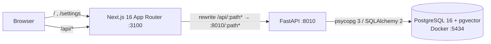
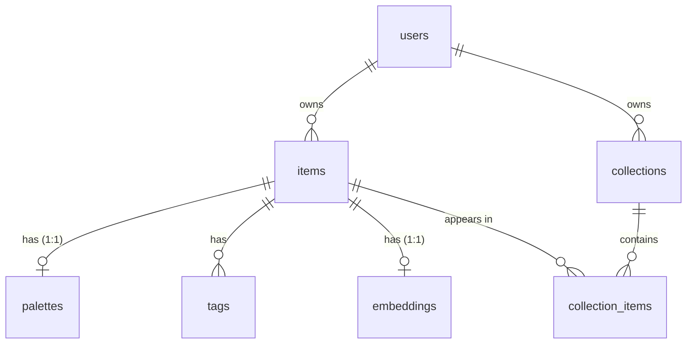

# Thread

A personal visual library for fashion: upload outfits, garments and fabric swatches, and Thread
extracts their palette, tags style and textile craft (including Indian traditions such as ikat,
bandhani and chikankari) and finds similar pieces in your own library.

> **Status: Milestone 2 (Database and persistence) complete.** The app shell, API skeleton,
> health checks, full PostgreSQL schema, Alembic migrations and owner-scoped repositories work.
> Upload, palette extraction, tagging and similarity search arrive in Milestones 3–6. This README
> documents only what exists today.

## Architecture (current)



The browser only talks to the Next.js origin. `/api/*` is proxied to FastAPI, so there is no CORS
configuration and, later, private images can stay behind the API.

## Repository layout

```
backend/            FastAPI app (Python 3.11)
  app/api/          routes, dependencies (current user), structured error handlers
  app/core/         settings (THREAD_ env prefix) and logging
  app/db/           declarative base, engine/session, Alembic helpers
  app/models/       SQLAlchemy 2 models (users, items, palettes, tags, embeddings, collections)
  app/repositories/ owner-scoped data access
  app/schemas/      Pydantic response models
  alembic.ini       Alembic config (no credentials; URL comes from THREAD_DATABASE_URL)
  tests/            pytest suite
frontend/           Next.js App Router + TypeScript (strict) + Tailwind 4
  src/app/          routes: / (landing), /settings (system status)
  src/components/   design-system primitives (Button, StatusBadge, header)
  src/features/     feature modules (landing hero, system status)
  src/lib, services, types   API client, typed API calls, API types
  e2e/              Playwright tests
database/init/      first-run shell script for the Postgres container (creates thread_test)
database/migrations/  Alembic env.py and versioned migrations
docker-compose.yml  PostgreSQL 16 with pgvector
.env.example        all configuration, placeholders only
```

## Prerequisites

| Tool | Version used | Notes |
|---|---|---|
| Docker Desktop | 29.x, Compose v2+ | must be **running** |
| uv | 0.11+ | installs Python 3.11 and the virtualenv |
| Node.js | 24.x (npm 11) | |

## Setup

All commands are run from the repository root unless a `cd` is shown.

**1. Configure environment**

```bash
cp .env.example .env
```

Replace `change-me-local-only` with a local password (it appears three times; keep them equal).
`.env` is git-ignored.

**2. Start PostgreSQL**

```bash
docker compose up -d --wait
```

The first start creates both the `thread` (development) and `thread_test` (automated tests)
databases.

**3. Backend**

```bash
cd backend
uv python install 3.11
uv venv --python 3.11 .venv
uv pip install --python .venv -r requirements-dev.txt
.venv/Scripts/alembic upgrade head
.venv/Scripts/python -m uvicorn app.main:app --reload --host 127.0.0.1 --port 8010
```

(On macOS/Linux use `.venv/bin/...`.) API docs: <http://127.0.0.1:8010/docs>.
`alembic upgrade head` creates the pgvector extension and every table; rerunning it is a no-op.
On startup the API creates the development user (see [Ownership](#ownership-and-the-development-user)).

**4. Frontend** (second terminal)

```bash
cd frontend
npm install
npm run dev
```

Open <http://127.0.0.1:3100>. The **System** page shows live API, PostgreSQL and pgvector status.

## Configuration

| Variable | Used by | Purpose |
|---|---|---|
| `POSTGRES_USER`, `POSTGRES_PASSWORD`, `POSTGRES_DB`, `POSTGRES_PORT` | Docker Compose | database container (host port defaults to 5434) |
| `THREAD_DATABASE_URL` | backend | SQLAlchemy URL, `postgresql+psycopg://…/thread` |
| `THREAD_TEST_DATABASE_URL` | backend tests | must point at `thread_test`, never the dev database |
| `THREAD_APP_ENV`, `THREAD_LOG_LEVEL` | backend | `development` / `test` / `production`; log level |
| `THREAD_DEV_USER_ID`, `THREAD_DEV_USER_NAME` | backend | optional; the local development owner (defaults are built in) |
| `THREAD_API_URL` | frontend (server side) | where the `/api` proxy forwards; default `http://127.0.0.1:8010` |

Backend settings are read **only** with the `THREAD_` prefix. Machine-wide variables from other
projects (for example a global `DATABASE_URL`) are ignored; a regression test enforces this.
The frontend loads the same root `.env` from `next.config.ts`.

## Database schema



| Table | Key points |
|---|---|
| `users` | One seeded development user for the MVP. |
| `items` | Storage keys (never filesystem paths), SHA-256 `content_hash` unique per user (duplicate detection), `processing_status` (queued / processing / completed / partially_completed / failed), user-safe `processing_error`, per-stage `stage_status` JSONB, `attempts`. |
| `palettes` | `colors` JSONB array of `{hex, name, percentage, lab}`; `color_families text[]` with a GIN index for fast colour filters; heuristic `harmony`. |
| `tags` | AI predictions and user corrections are **separate rows** (`source` = `ai` / `user`, `user_action` = `add` / `remove`). Re-analysis rewrites only AI rows, so corrections survive. `confidence` is a raw model score in [0, 1], not a calibrated probability. A CHECK constraint keeps the two kinds of row consistent. |
| `embeddings` | `vector(512)` (OpenCLIP ViT-B/32) with an HNSW index using `vector_cosine_ops`. The dimension is frozen in the migration; the worker will verify the model's real output size before writing. |
| `collections` | Names unique per user, case-insensitively (`lower(name)` unique index). |
| `collection_items` | Stores `user_id` so two **composite foreign keys** — `(collection_id, user_id)` and `(item_id, user_id)` — make it impossible, at the database level, to put one user's item in another user's collection. |

Closed vocabularies use `VARCHAR` + `CHECK` constraints rather than native Postgres enums, so
adding a value later is a simple constraint swap. Deleting an item cascades to its palette, tags,
embedding and collection memberships; deleting a collection never deletes items.

### Migrations

```bash
cd backend
.venv/Scripts/alembic upgrade head        # apply
.venv/Scripts/alembic current             # applied revision
.venv/Scripts/alembic downgrade -1        # step back
.venv/Scripts/alembic revision --autogenerate -m "describe change"   # after editing models
```

Autogenerated migrations are always reviewed by hand. A test asserts the models and migrations
never drift apart. The migration creates the `vector` extension, which needs a role allowed to
create extensions (the Docker development role is a superuser; managed Postgres services usually
require enabling pgvector in their console).

### Ownership and the development user

Every repository is constructed with the current user's id and filters every query by it; another
user's rows behave exactly like missing rows (404, never 403, so ids cannot be probed).
For the local MVP, `get_current_user_id` returns a fixed development user
(`THREAD_DEV_USER_ID`, created on startup). **This is not authentication**: the dependency refuses
to run when `THREAD_APP_ENV=production`, so real authentication must be added before any
deployment.

## Health check

`GET /health` (or `/api/health` through the frontend) returns:

```json
{"status":"ok","app":"Thread API","version":"0.1.0","environment":"development",
 "database":{"status":"ok","server_version":"16.15","pgvector_available":true,"latency_ms":7.2,
             "schema_revision":"b987c40bd0a0","schema_head":"b987c40bd0a0","schema_up_to_date":true}}
```

It returns **503** with `"status":"degraded"` if PostgreSQL is down (`"database":{"status":"unavailable",…}`)
or if migrations are behind the code (`"schema_up_to_date": false`). Driver error messages and connection strings are never
returned or logged; the log records only the error class.

## Tests and checks

```bash
# backend (from backend/)
.venv/Scripts/ruff check .
.venv/Scripts/ruff format --check .
.venv/Scripts/python -m pytest -v

# frontend (from frontend/)
npm run lint
npm run typecheck
npm test                       # Vitest unit/component tests
npx playwright install chromium   # once
npm run test:e2e               # Playwright; needs Docker Postgres running, starts/reuses both servers
npm run build
```

Run Ruff on migrations too: `.venv/Scripts/ruff check . ../database/migrations`.

Database tests (`-m db`) never touch the development database. They connect to `thread_test` only
to create **disposable databases with random names**, migrate them with the real Alembic
migrations, and drop them afterwards. Each test runs inside a transaction that is rolled back.
They are skipped with a clear reason if Postgres is not reachable.

## Troubleshooting

- **`port is already allocated` on `docker compose up`**: another container uses the port. Set a
  free `POSTGRES_PORT` in `.env` and update the port in both `THREAD_*DATABASE_URL` values.
- **Ports 8010 / 3100 busy**: these were chosen because 8000 and 3000 are commonly used by other
  local projects. Change the uvicorn `--port`, `THREAD_API_URL`, and the `dev` script together.
- **`/health` reports the database unavailable**: check `docker compose ps` shows `thread-db` as
  healthy, and that the password in `THREAD_DATABASE_URL` matches `POSTGRES_PASSWORD`.
- **Password changed after first start**: Postgres keeps the original password in the volume.
  Reset (deletes local data): `docker compose down -v` then `docker compose up -d --wait`.
- **`/health` says migrations are pending** (System page shows "Pending"): run
  `.venv/Scripts/alembic upgrade head` from `backend/`, then restart the API so it creates the
  development user.
- **`permission denied to create extension "vector"`**: the database role cannot create
  extensions. Use the Docker Compose database, or enable pgvector as an administrator.
- **`ModuleNotFoundError: asyncpg`** or another project's database name: a generic variable is
  leaking in. Thread only reads `THREAD_*` variables; make sure your `.env` uses those names.

## Roadmap

Milestones 3–8: upload and storage, palette extraction, OpenCLIP
embeddings and tags, pgvector similarity, gallery and collections, end-to-end quality and full
documentation.
