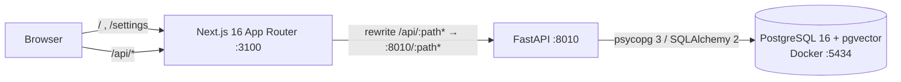

# Thread

A personal visual library for fashion: upload outfits, garments and fabric swatches, and Thread
extracts their palette, tags style and textile craft (including Indian traditions such as ikat,
bandhani and chikankari) and finds similar pieces in your own library.

> **Status: Milestone 1 (Foundation) complete.** The app shell, API skeleton, database
> connectivity and health checks work. Upload, palette extraction, tagging and similarity search
> arrive in Milestones 3–6. This README documents only what exists today.

## Architecture (current)



The browser only talks to the Next.js origin. `/api/*` is proxied to FastAPI, so there is no CORS
configuration and, later, private images can stay behind the API.

## Repository layout

```
backend/            FastAPI app (Python 3.11)
  app/api/          routes and structured error handlers
  app/core/         settings (THREAD_ env prefix) and logging
  app/db/           SQLAlchemy engine and session dependency
  app/schemas/      Pydantic response models
  tests/            pytest suite
frontend/           Next.js App Router + TypeScript (strict) + Tailwind 4
  src/app/          routes: / (landing), /settings (system status)
  src/components/   design-system primitives (Button, StatusBadge, header)
  src/features/     feature modules (landing hero, system status)
  src/lib, services, types   API client, typed API calls, API types
  e2e/              Playwright tests
database/init/      first-run SQL/shell for the Postgres container (creates thread_test)
docker-compose.yml  PostgreSQL 16 with pgvector
.env.example        all configuration, placeholders only
```

## Prerequisites

| Tool | Version used | Notes |
|---|---|---|
| Docker Desktop | 29.x, Compose v2+ | must be **running** |
| uv | 0.11+ | installs Python 3.11 and the virtualenv |
| Node.js | 24.x (npm 11) | |

## Setup

All commands are run from the repository root unless a `cd` is shown.

**1. Configure environment**

```bash
cp .env.example .env
```

Replace `change-me-local-only` with a local password (it appears three times; keep them equal).
`.env` is git-ignored.

**2. Start PostgreSQL**

```bash
docker compose up -d --wait
```

The first start creates both the `thread` (development) and `thread_test` (automated tests)
databases.

**3. Backend**

```bash
cd backend
uv python install 3.11
uv venv --python 3.11 .venv
uv pip install --python .venv -r requirements-dev.txt
.venv/Scripts/python -m uvicorn app.main:app --reload --host 127.0.0.1 --port 8010
```

(On macOS/Linux use `.venv/bin/python`.) API docs: <http://127.0.0.1:8010/docs>.

**4. Frontend** (second terminal)

```bash
cd frontend
npm install
npm run dev
```

Open <http://127.0.0.1:3100>. The **System** page shows live API, PostgreSQL and pgvector status.

## Configuration

| Variable | Used by | Purpose |
|---|---|---|
| `POSTGRES_USER`, `POSTGRES_PASSWORD`, `POSTGRES_DB`, `POSTGRES_PORT` | Docker Compose | database container (host port defaults to 5434) |
| `THREAD_DATABASE_URL` | backend | SQLAlchemy URL, `postgresql+psycopg://…/thread` |
| `THREAD_TEST_DATABASE_URL` | backend tests | must point at `thread_test`, never the dev database |
| `THREAD_APP_ENV`, `THREAD_LOG_LEVEL` | backend | `development` / `test` / `production`; log level |
| `THREAD_API_URL` | frontend (server side) | where the `/api` proxy forwards; default `http://127.0.0.1:8010` |

Backend settings are read **only** with the `THREAD_` prefix. Machine-wide variables from other
projects (for example a global `DATABASE_URL`) are ignored; a regression test enforces this.
The frontend loads the same root `.env` from `next.config.ts`.

## Health check

`GET /health` (or `/api/health` through the frontend) returns:

```json
{"status":"ok","app":"Thread API","version":"0.1.0","environment":"development",
 "database":{"status":"ok","server_version":"16.15","pgvector_available":true,"latency_ms":12.8}}
```

If PostgreSQL is down it returns **503** with `"status":"degraded"` and
`"database":{"status":"unavailable",…}`. Driver error messages and connection strings are never
returned or logged; the log records only the error class.

## Tests and checks

```bash
# backend (from backend/)
.venv/Scripts/ruff check .
.venv/Scripts/ruff format --check .
.venv/Scripts/python -m pytest -v

# frontend (from frontend/)
npm run lint
npm run typecheck
npm test                       # Vitest unit/component tests
npx playwright install chromium   # once
npm run test:e2e               # Playwright; needs Docker Postgres running, starts/reuses both servers
npm run build
```

The database tests (`-m db`) use `thread_test` and are skipped with a clear reason if it is not
reachable.

## Troubleshooting

- **`port is already allocated` on `docker compose up`**: another container uses the port. Set a
  free `POSTGRES_PORT` in `.env` and update the port in both `THREAD_*DATABASE_URL` values.
- **Ports 8010 / 3100 busy**: these were chosen because 8000 and 3000 are commonly used by other
  local projects. Change the uvicorn `--port`, `THREAD_API_URL`, and the `dev` script together.
- **`/health` reports the database unavailable**: check `docker compose ps` shows `thread-db` as
  healthy, and that the password in `THREAD_DATABASE_URL` matches `POSTGRES_PASSWORD`.
- **Password changed after first start**: Postgres keeps the original password in the volume.
  Reset (deletes local data): `docker compose down -v` then `docker compose up -d --wait`.
- **`ModuleNotFoundError: asyncpg`** or another project's database name: a generic variable is
  leaking in. Thread only reads `THREAD_*` variables; make sure your `.env` uses those names.

## Roadmap

Milestones 2–8: schema and migrations, upload and storage, palette extraction, OpenCLIP
embeddings and tags, pgvector similarity, gallery and collections, end-to-end quality and full
documentation.
