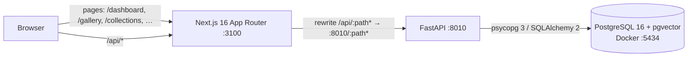
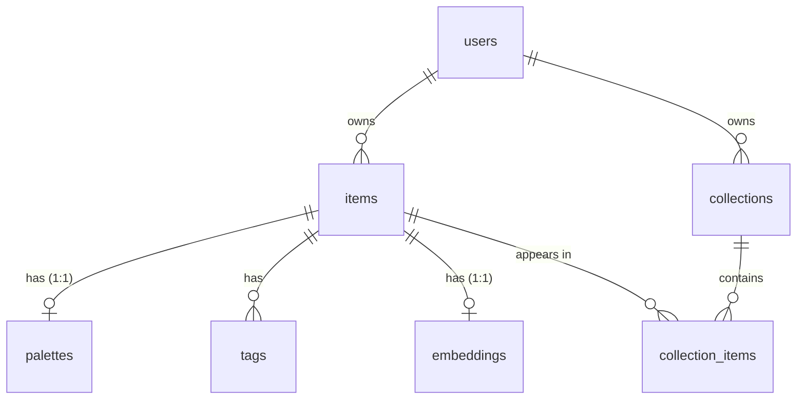

# Thread

A personal visual library for fashion: upload outfits, garments and fabric swatches, and Thread
extracts their palette, tags style and textile craft (including Indian traditions such as ikat,
bandhani and chikankari) and finds similar pieces in your own library.

> **Status: Milestone 7 (Search, filters, collections and dashboard) complete.** You can upload
> images (drag and drop, file picker or phone camera), browse them in a gallery, edit and delete
> them. Every upload gets a real colour palette (hex/RGB, human and Indian colour names,
> percentages, heuristic harmony, PNG card), an OpenCLIP image embedding and **zero-shot fashion
> tags** (garment, silhouette, pattern, fabric guess, aesthetic, occasion, Indian crafts) that you
> can correct. Each item page shows **similar pieces from your own library** in three modes. The
> gallery has **text search and tag, colour-family and type filters** kept in the URL, pieces can
> be gathered into **ordered, annotated collections**, and a **dashboard** summarises the library.
> Tag accuracy has not been measured (see Limitations). This README documents only what exists
> today.

## Architecture (current)



The browser only talks to the Next.js origin. `/api/*` is proxied to FastAPI, so there is no CORS
configuration and, later, private images can stay behind the API.

## Repository layout

```
backend/            FastAPI app (Python 3.11)
  app/api/          routes, dependencies (current user), structured error handlers
  app/color/        LAB maths, palette extraction, naming, harmony, PNG card (+ data/ name lists)
  app/ml/           pinned model spec, OpenCLIP embedder, lazily loaded registry, tag vocabulary
                    (vocabulary.py) and zero-shot tagger with its text-vector cache (tagging.py)
  scripts/          fetch_model.py (explicit, one-off weights download)
  app/core/         settings (THREAD_ env prefix) and logging
  app/db/           declarative base, engine/session, Alembic helpers
  app/models/       SQLAlchemy 2 models (users, items, palettes, tags, embeddings, collections)
  app/repositories/ owner-scoped data access
  app/schemas/      Pydantic request/response models
  app/services/     image validation, upload/delete use-cases, palette extraction for items
  app/storage/      storage interface (base.py) and local filesystem backend (local.py)
  alembic.ini       Alembic config (no credentials; URL comes from THREAD_DATABASE_URL)
  tests/            pytest suite
frontend/           Next.js App Router + TypeScript (strict) + Tailwind 4
  src/app/          routes: / (landing), /upload, /gallery, /items/[id], /settings (system status)
  src/components/   design-system primitives (Button, StatusBadge, header)
  src/features/     feature modules (landing hero, system status)
  src/lib, services, types   API client, typed API calls, API types
  e2e/              Playwright tests
database/init/      first-run shell script for the Postgres container (creates thread_test)
database/migrations/  Alembic env.py and versioned migrations
docker-compose.yml  PostgreSQL 16 with pgvector
.env.example        all configuration, placeholders only
```

## Prerequisites

| Tool | Version used | Notes |
|---|---|---|
| Docker Desktop | 29.x, Compose v2+ | must be **running** |
| uv | 0.11+ | installs Python 3.11 and the virtualenv |
| Node.js | 24.x (npm 11) | |

## Setup

All commands are run from the repository root unless a `cd` is shown.

**1. Configure environment**

```bash
cp .env.example .env
```

Replace `change-me-local-only` with a local password (it appears three times; keep them equal).
`.env` is git-ignored.

**2. Start PostgreSQL**

```bash
docker compose up -d --wait
```

The first start creates both the `thread` (development) and `thread_test` (automated tests)
databases.

**3. Backend**

```bash
cd backend
uv python install 3.11
uv venv --python 3.11 .venv
uv pip install --python .venv -r requirements-dev.txt
.venv/Scripts/alembic upgrade head
.venv/Scripts/python -m scripts.fetch_model      # optional, once: ~577 MiB image model (see below)
.venv/Scripts/python -m uvicorn app.main:app --reload --host 127.0.0.1 --port 8010
```

To keep every download inside the project, pass a project-local uv cache when installing, e.g.
`uv pip install --python .venv --cache-dir ../.cache/uv -r requirements-dev.txt` (≈140 MB of
wheels; PyTorch is ≈118 MB of that and installs to ≈450 MB).

(On macOS/Linux use `.venv/bin/...`.) API docs: <http://127.0.0.1:8010/docs>.
`alembic upgrade head` creates the pgvector extension and every table; rerunning it is a no-op.
On startup the API creates the development user (see [Ownership](#ownership-and-the-development-user)).

**4. Frontend** (second terminal)

```bash
cd frontend
npm install
npm run dev
```

Open <http://127.0.0.1:3100>. The **System** page shows live API, PostgreSQL and pgvector status.

## Configuration

| Variable | Used by | Purpose |
|---|---|---|
| `POSTGRES_USER`, `POSTGRES_PASSWORD`, `POSTGRES_DB`, `POSTGRES_PORT` | Docker Compose | database container (host port defaults to 5434) |
| `THREAD_DATABASE_URL` | backend | SQLAlchemy URL, `postgresql+psycopg://…/thread` |
| `THREAD_TEST_DATABASE_URL` | backend tests | must point at `thread_test`, never the dev database |
| `THREAD_APP_ENV`, `THREAD_LOG_LEVEL` | backend | `development` / `test` / `production`; log level |
| `THREAD_DEV_USER_ID`, `THREAD_DEV_USER_NAME` | backend | optional; the local development owner (defaults are built in) |
| `THREAD_STORAGE_DIR` | backend | where uploaded files are stored (default `storage/`) |
| `THREAD_MAX_UPLOAD_BYTES`, `THREAD_MAX_IMAGE_SIDE`, `THREAD_MIN_IMAGE_SIDE`, `THREAD_MAX_IMAGE_PIXELS`, `THREAD_THUMBNAIL_SIDE` | backend (+ proxy limit) | upload limits; defaults 15 MB, 8000 px, 64 px, 40 MP, 640 px |
| `THREAD_PALETTE_SIZE` | backend | colours to extract per image, 1–12 (default 6) |
| `THREAD_MODEL_CACHE_DIR` | backend | where the image-model weights live (default `.cache/models`) |
| `THREAD_EMBEDDINGS_ENABLED`, `THREAD_EMBEDDING_WARMUP` | backend | turn similarity off; load the model at start-up in the background (both default `true`) |
| `THREAD_API_URL` | frontend (server side) | where the `/api` proxy forwards; default `http://127.0.0.1:8010` |

Backend settings are read **only** with the `THREAD_` prefix. Machine-wide variables from other
projects (for example a global `DATABASE_URL`) are ignored; a regression test enforces this.
The frontend loads the same root `.env` from `next.config.ts`.

## Database schema



| Table | Key points |
|---|---|
| `users` | One seeded development user for the MVP. |
| `items` | Storage keys (never filesystem paths), SHA-256 `content_hash` unique per user (duplicate detection), `processing_status` (queued / processing / completed / partially_completed / failed), user-safe `processing_error`, per-stage `stage_status` JSONB, `attempts`. |
| `palettes` | `colors` JSONB array of `{hex, name, percentage, lab}`; `color_families text[]` with a GIN index for fast colour filters; heuristic `harmony`. |
| `tags` | AI predictions and user corrections are **separate rows** (`source` = `ai` / `user`, `user_action` = `add` / `remove`). Re-analysis rewrites only AI rows, so corrections survive. `confidence` is a raw model score in [0, 1], not a calibrated probability. A CHECK constraint keeps the two kinds of row consistent. |
| `embeddings` | `vector(512)` (OpenCLIP ViT-B/32) with an HNSW index using `vector_cosine_ops`. The dimension is frozen in the migration; the worker will verify the model's real output size before writing. |
| `collections` | Names unique per user, case-insensitively (`lower(name)` unique index). |
| `collection_items` | Stores `user_id` so two **composite foreign keys** — `(collection_id, user_id)` and `(item_id, user_id)` — make it impossible, at the database level, to put one user's item in another user's collection. |

Closed vocabularies use `VARCHAR` + `CHECK` constraints rather than native Postgres enums, so
adding a value later is a simple constraint swap. Deleting an item cascades to its palette, tags,
embedding and collection memberships; deleting a collection never deletes items.

### Migrations

```bash
cd backend
.venv/Scripts/alembic upgrade head        # apply
.venv/Scripts/alembic current             # applied revision
.venv/Scripts/alembic downgrade -1        # step back
.venv/Scripts/alembic revision --autogenerate -m "describe change"   # after editing models
```

Autogenerated migrations are always reviewed by hand. A test asserts the models and migrations
never drift apart. The migration creates the `vector` extension, which needs a role allowed to
create extensions (the Docker development role is a superuser; managed Postgres services usually
require enabling pgvector in their console).

### Ownership and the development user

Every repository is constructed with the current user's id and filters every query by it; another
user's rows behave exactly like missing rows (404, never 403, so ids cannot be probed).
For the local MVP, `get_current_user_id` returns a fixed development user
(`THREAD_DEV_USER_ID`, created on startup). **This is not authentication**: the dependency refuses
to run when `THREAD_APP_ENV=production`, so real authentication must be added before any
deployment.

## Uploads and storage

### API

| Method & path | Purpose |
|---|---|
| `POST /items` | Multipart upload: `file` (required), `type` (`outfit`/`garment`/`fabric`/`accessory`/`other`, default `other`). Returns **201** with the item. |
| `GET /items?type=&limit=&offset=` | Your items, newest first, with `total` for paging. |
| `GET /items/{id}` | One item. |
| `PATCH /items/{id}` | Change `type`, `notes` (≤ 5000 chars) or `source_url` (http/https only). `null` clears notes/URL. |
| `DELETE /items/{id}` | **204**; removes the record and its files. |
| `GET /items/{id}/image?variant=original\|thumbnail` | The stored image, after an ownership check. |

Errors use one JSON shape, `{"error": {"code", "message", "details"}}`:

| Status | `code` | When |
|---|---|---|
| 409 | `conflict` | Same file already in your library; `details.existing_item_id` points at it |
| 413 | `too_large` | Larger than `THREAD_MAX_UPLOAD_BYTES` (15 MB) |
| 415 | `unsupported_format` | A real image, but not JPEG, PNG or WebP (e.g. GIF, BMP, TIFF) |
| 422 | `invalid_image` / `bad_dimensions` / `validation_error` | Not an image, damaged/truncated, outside the size limits, or a bad field |

### What happens to an upload

1. The body is read in chunks and refused as soon as it exceeds the size limit.
2. The **bytes** are inspected with Pillow — the filename and the browser's Content-Type are
   ignored. Only JPEG, PNG and WebP pass.
3. Dimensions are checked from the header **before** any pixels are decoded (max 8000 px per
   side, min 64 px, max 40 MP), which stops decompression bombs; then the image is fully decoded
   to catch truncated or corrupt files.
4. A SHA-256 of the uploaded bytes detects duplicates per user.
5. The camera's EXIF orientation is applied, then the image is re-encoded **without EXIF or other
   metadata** (photos can carry GPS location). The ICC colour profile is kept so colours stay
   accurate for palette extraction. A 640 px WebP thumbnail is generated.
6. Files are written, then the database row is committed (`processing_status = queued`).

**Consistency.** If writing a file or the database insert fails, every file written for that
upload is deleted again, so a row never points at a missing file. Deleting commits the row
removal first, then removes files. The worst case after a crash is an unreferenced file on disk,
never a broken row. On Windows a file cannot be deleted while another request has it open (for
example the same image being served at that moment, `WinError 32`); such locks last
milliseconds, so the local storage retries a delete for up to ≈0.75 s before giving up and
logging it.

### Storage

Files live under `THREAD_STORAGE_DIR` (default `storage/` at the repo root, git-ignored), outside
anything the frontend serves publicly. Keys are generated by the server —
`users/<user-id>/items/<item-id>/original.<ext>` and `.../thumbnail.webp` — never derived from user
filenames. The local backend validates every key against a strict pattern, refuses anything that
resolves outside the root (path traversal), and opens files in exclusive-create mode so nothing is
overwritten. Images are only reachable through `GET /items/{id}/image`, which checks ownership and
accepts only the two named variants; responses carry `Cache-Control: private`,
`X-Content-Type-Options: nosniff` and a restrictive `Content-Security-Policy`.

To add S3 or Cloudinary later, implement the `Storage` protocol in `app/storage/base.py`
(`save`, `read`, `delete`, `exists`) and return it from `get_storage` in `app/api/deps.py`.

### Proxy body size

The Next.js `/api` proxy buffers request bodies and truncates them at 10 MB by default, which
breaks larger uploads. `next.config.ts` raises `experimental.proxyClientMaxBodySize` to twice
`THREAD_MAX_UPLOAD_BYTES`, so slightly-too-large files still reach FastAPI and get a proper 413.
The upload page also rejects files over 15 MB before sending them.

## Colour palettes

Every upload gets a palette right after it is safely stored (a quick in-process step, typically
well under a second; it will become a stage of the background worker in a later milestone). If
extraction fails the upload still succeeds, the item records `stage_status.palette = "failed"`
with a readable `processing_error`, and **no palette is shown** — colours are never guessed.

| Method & path | Purpose |
|---|---|
| `POST /items/{id}/palette?colors=1..12` | (Re-)extract from the stored image; replaces the earlier palette (upsert). 422 `palette_failed` on failure — a palette extracted earlier is kept. |
| `GET /items/{id}/palette.png` | 1200×675 PNG palette card (download). 404 if there is no palette. |

Items include `palette` (`colors[]` with `hex`, `rgb`, `name`, `family`, `percentage`; `harmony`;
`source`), `stage_status` and `palette_card_url`.

### How LAB colour clustering works

1. **Downscale** to at most 256 px with *nearest-neighbour* sampling. Averaging filters would
   invent blended in-between colours along edges, which would appear as fake swatches.
2. **Choose pixels.** Transparent pixels (alpha < 128) are ignored. For photos (not fabric
   swatches) a cheap backdrop test runs: if ≥ 85% of the border ring is one colour (CIEDE2000 < 8
   from its median), pixels clearly different from it (ΔE ≥ 12) are the subject. The mask is only
   used when the subject covers 5–95% of the image; otherwise the whole image is used. The API
   reports this as `source: "masked"` or `"original"`. (Model-based background removal is planned
   for a later milestone.)
3. **Convert sRGB → CIELAB** (D65). In LAB, equal distances look roughly equally different, so
   clusters group colours the way people see them. Up to 20 000 pixels are sampled with a fixed seed.
4. **K-means** (scikit-learn, k = `THREAD_PALETTE_SIZE`, default 6, fixed `random_state`), capped
   at the number of distinct colours so tiny or flat images work.
5. **Merge** clusters closer than CIEDE2000 6 (one colour, not two), and **drop slivers** under 1%
   (edge noise, specks).
6. **Percentages** from cluster sizes, rounded with the largest-remainder method so they sum to
   exactly 100.0.
7. **Convert each LAB centroid back to sRGB** (clipped to the displayable gamut, rounded). The hex,
   RGB and stored LAB all describe that final sRGB colour, so the swatch on screen and the hex a
   user copies are identical.

Results are deterministic: the same image always gives the same palette.

### Names, families and harmony

- **Names** are the nearest reference colour by CIEDE2000 among the
  [xkcd colour survey](https://xkcd.com/color/rgb.txt) (949 names, CC0, stored in
  `backend/app/color/data/xkcd_colors.json`) and a curated Indian vocabulary
  (`indian_colors.json`: haldi yellow, sindoor red, gulabi pink, mehendi green, neel indigo, rani
  pink, firozi turquoise …). The Indian hex values are representative shades chosen for this
  project, not a formal standard. Ties go to the first entry, so naming is deterministic.
  Naming lives in its own module (`naming.py`) so it can be improved without touching extraction.
- **Families** (red, orange, yellow, green, teal, blue, purple, pink, brown, beige, white, grey,
  black) come from LCh lightness/chroma/hue ranges calibrated against reference colours, and are
  stored in `palettes.color_families` (GIN-indexed) for colour filtering later.
- **Harmony is a heuristic**, labelled as such in the UI. Using hues of clearly coloured swatches
  (chroma ≥ 12, ≥ 5% share) in perceptual LCh space: *neutral* (none), *monochromatic* (within
  30°), *analogous* (within 75°), *complementary* (two tight groups 150–210° apart), else *mixed*.
  Note LCh is not the painter's RYB wheel: e.g. orange and a saturated royal blue are not opposite
  in LCh, so that pair is labelled *mixed*.

### Limitations

Palettes describe the **photo**, not the fabric: lighting colour, camera white balance, shadows,
highlights, sheen and JPEG compression all shift colours (a re-saved JPEG can move a hex by a unit
or two). Percentages are shares of the analysed pixels, so a photo's background counts unless it
is a plain backdrop the mask can detect. Busy backgrounds are not removed yet. Treat the output as
a faithful summary of the image, not a lab measurement of the garment.

## Visual similarity (OpenCLIP + pgvector)

Each image gets a 512-dimensional embedding from **OpenCLIP ViT-B/32** (`laion2b_s34b_b79k`), and
"Similar pieces" on the item page lists your own most similar items by cosine similarity.

### The model, pinned

| | |
|---|---|
| Weights | `laion/CLIP-ViT-B-32-laion2B-s34B-b79K` → `open_clip_model.safetensors`, revision `1a25a446712ba5ee05982a381eed697ef9b435cf`, 605,143,316 bytes, SHA-256 `ac4f8c4b…56e6` (MIT licence) |
| Stored at | `<repo>/.cache/models/ViT-B-32-laion2b_s34b_b79k/` (git-ignored; `THREAD_MODEL_CACHE_DIR`) |
| Identifier | `open_clip/ViT-B-32/laion2b_s34b_b79k@1a25a44/pp1` — stored with every vector |
| Runtime | CPU only (PyPI's Windows PyTorch wheel); 4 torch threads; ≈0.12 s per image |

`python -m scripts.fetch_model` downloads exactly that file from the pinned revision, verifies the
SHA-256, and points every Hugging Face cache for that process into `.cache/models` — nothing goes
to the user-wide cache and no global settings change. **The API never downloads**: it loads the
local file or reports the model as unavailable.

### Exact preprocessing ("pp1")

Indexing and search use the same path — search compares the stored vector of the query item:

1. Flatten transparency onto white (RGBA/LA/P-with-alpha), convert to RGB.
2. OpenCLIP's eval transform for this checkpoint: resize the shorter side to 224 px (bicubic),
   centre-crop 224×224, scale to [0, 1], normalise with mean (0.48145466, 0.4578275,
   0.40821073) and std (0.26862954, 0.26130258, 0.27577711).
3. `encode_image` in float32, then **L2-normalise**, so cosine similarity = dot product and
   pgvector's cosine distance `<=>` = 1 − similarity.

The loaded model must produce 512-d vectors (checked at load) to match the `vector(512)` column.
If the architecture, checkpoint, revision, preprocessing or normalisation ever changes, the
identifier must change too: search only compares vectors with the **current** identifier and
re-indexes older ones, so incompatible vectors are never mixed.

### When indexing happens (no background worker yet)

- The model loads **lazily, once per API process**, in a background thread at start-up if the
  weights exist (≈15–20 s, mostly importing PyTorch; ≈55 s the very first time from a cold disk).
  Start-up never waits for it, and nothing depends on it.
- **Uploads never wait for the model.** If it is loaded, the upload is indexed (+≈0.12 s). If it
  is still loading, `stage_status.embedding` is `pending`; without weights it is `unavailable`.
  Either way the upload and its palette succeed.
- `GET /items/{id}/similar?limit=1..50` (default 12) **never waits for the model either**. While it
  loads, the API answers at once with `503 model_loading` and `Retry-After: 5` (and makes sure the
  background load is running); the UI shows "Loading the image model…" and retries every 3 s.
  Waiting inside one request was tried first and failed: a cold load (≈55 s) outlasted the
  Next.js proxy's 30 s timeout. Once the model is ready, the request indexes the query item and
  up to 50 of your not-yet-indexed items, then searches. Embeddings are deterministic, so
  indexing late gives exactly the same vector as indexing early. Items whose embedding
  **failed** are counted (`not_indexed`) but not retried on every search.
- `POST /items/{id}/embedding` re-indexes one item on demand.
- `processing_status` now reflects the stages that exist (palette + embedding): `completed`,
  `partially_completed` (e.g. no model installed), `queued` (embedding pending) or `failed`.

### The query

```sql
SET LOCAL hnsw.iterative_scan = relaxed_order;   -- pgvector >= 0.8
SELECT items.*, embeddings.vector <=> :query AS distance
FROM items JOIN embeddings ON embeddings.item_id = items.id
WHERE items.user_id = :owner AND items.id <> :query_item AND embeddings.model_name = :model
ORDER BY distance LIMIT :limit;
```

Ownership is part of the WHERE clause, so other users' items can never be returned — not even an
identical image. The HNSW index (`vector_cosine_ops`) is approximate; `iterative_scan` keeps it
scanning when the owner filter removes candidates, and results are re-sorted by exact distance.
Errors: `503 model_loading` (retry soon), `503 model_unavailable` (not installed / failed to
load), `422 embedding_failed`.

### Limitations

CLIP compares whole images, not garments: background, framing, lighting and colour all count, so
two photos of different garments on the same backdrop can score high, and the same garment shot
differently can score lower. Scores are **relative** (good for ranking within your library) and
not calibrated probabilities; in our checks even unrelated images scored around 0.6–0.7. The
model was trained on web images and may handle some regional garments and textiles less well.

## Fashion tags (zero-shot)

AI tags come from the same OpenCLIP checkpoint's **text encoder** — no extra model or download
(the tokenizer's BPE vocabulary ships inside the `open_clip` package).

### The vocabulary

`backend/app/ml/vocabulary.py` is the single source of truth: seven categories matching the
database's `ck_tags_category` constraint, each with labels, descriptive phrases and thresholds.

| Category | Stored per image | Notes |
|---|---|---|
| garment | 1 | kurta, saree, lehenga, salwar suit, blazer, shirt, trousers, dress, skirt, jacket, dupatta, accessory; skipped for fabric swatches |
| silhouette | 1 | oversized, fitted, relaxed, straight, a-line, flared, draped, structured, layered; skipped for fabric and accessories |
| pattern | up to 2 | solid, floral, striped, plaid, houndstooth, geometric, paisley, embroidery, polka dot, abstract |
| fabric | 1 | cotton, silk, linen, denim, wool, chiffon, georgette, velvet, leather, knit — **always shown as a guess** |
| aesthetic / occasion | up to 2 each | minimalist, boho, streetwear, traditional, contemporary, classic / festive, bridal, casual, formal, occasionwear |
| craft | up to 2 | ikat, bandhani, chikankari, kanjeevaram, banarasi brocade, kalamkari, ajrakh, chanderi, paithani, block print, phulkari, zardozi |

Garment, silhouette and craft also contain a **"none of these"** option (e.g. "plain fabric with
no traditional craft"). It competes in scoring but is never stored, so the model can decline
instead of being forced to pick a craft for a plain shirt.

### How tags are computed

1. Each label's phrases are put into three prompt templates (version `pt1`, e.g. "a photo of
   {}.") and encoded once; a label's text vector is the normalised mean of its prompts.
2. Text vectors are **cached on disk** in `.cache/models/text/ViT-B-32/text-<key>.npz`. The key
   hashes the **model identifier + prompt-template version + vocabulary hash**, and the same
   metadata is stored inside the file and re-checked on load, so a model, prompt or vocabulary
   change can never reuse incompatible vectors. Building the cache takes ~20 s once; loading it
   takes about a second.
3. The item's **stored image embedding** (no image re-read) is compared with every label of a
   category: `softmax(100 × cosine)` within the category gives relative scores.
4. **Conservative display rules:** the top label is stored only if it clears the category's
   minimum score **and** beats the runner-up by a margin; multi-label categories may add further
   labels above the minimum. If "none of these" wins, nothing is stored. The thresholds were set
   by reasoning, not fitted to data — no labelled dataset exists for this project.
5. The same method suggests an item type (`suggested_type`), shown as a suggestion only.

Scores are labelled **relative and uncalibrated** everywhere; they are not probabilities.
"Show all scores" on the item page lists every label's score, the thresholds, and which labels
passed (`GET /items/{id}/tag-scores`).

### Your corrections are kept separately

AI tags and your edits are different rows in `tags` (`source` = `ai` / `user`). Shown tags are
**AI tags + your additions − your removals**. Re-analysis (`POST /items/{id}/reanalyze`) deletes
and rewrites **only AI rows**, so corrections always survive; it is idempotent (no duplicate
rows). Every AI row is stamped with the tagger version
(`<model>/pt1/v<vocabulary hash>`); when the model, prompts or vocabulary change, outdated AI tags
are replaced the next time the item is viewed or re-analysed.

You may add tags from the vocabulary or **custom tags** within a category (shown as "custom"):
1–40 characters of letters, numbers, spaces and `' & / -`, normalised to lowercase, no
duplicates, at most 40 added tags per item, and only on your own items.

| Method & path | Purpose |
|---|---|
| `GET /items/{id}/tags` | Shown tags, AI tags you removed, status, version, suggested type. Tags (and, if needed, indexes) the item if the model is ready |
| `PATCH /items/{id}/tags` | `{"add": [{category, tag}], "remove": [...]}`; removing an AI tag hides it, adding it back restores it. `422 invalid_tag` on bad input |
| `GET /items/{id}/tag-scores` | Every label's score; `409 not_indexed`, `503 model_loading` / `model_unavailable` |
| `GET /tags/vocabulary` | Suggestions for adding tags |
| `POST /items/{id}/reanalyze` | Palette, embedding and AI tags again; never waits for the model |

### Similarity modes

`GET /items/{id}/similar?mode=visual|palette|fabric` — every result lists its **reasons**.

- **visual** — unchanged (cosine similarity of image embeddings).
- **palette — same palette, different silhouette.** Ranks your items by
  `palette_distance`: each colour is matched to the nearest colour of the other palette by
  CIEDE2000, weighted by its share, averaged over both directions (lower = closer). Items sharing
  the query's silhouette or garment tag are excluded — **only when both items have that tag**;
  otherwise they stay in, marked "shape unknown". Needs no image model, so it works while the
  model loads or without it. `422 palette_missing` if the item has no palette.
- **fabric — same fabric, different colour.** Takes the 100 nearest visual neighbours, keeps
  those sharing at least one fabric, pattern or craft tag with the query, and lists pieces with a
  **different dominant colour family first**. If the item has no such tag, the response says so
  instead of guessing.

### Limitations of tags

Accuracy **has not been measured**: there is no labelled evaluation set, and the automated tests
check mechanics (scoring, thresholds, caching, corrections, ownership), not correctness. In
particular, fabric composition cannot be determined reliably from a photo (hence "guess"), CLIP
knows some Indian craft names only weakly, and tags describe the photo as a whole. Correct tags
freely — corrections are never overwritten — and use "Show all scores" to see how close calls were.

## Search, filters and collections

### Gallery search and filters

`GET /items` takes, all optional and combinable (AND):

| Parameter | Meaning |
| --- | --- |
| `q` (≤100 chars) | Case-insensitive text match against visible tags, colour names, colour families, type, notes and source URL. `%`, `_` and `\` are matched literally. |
| `tag` (repeatable, ≤10) | `category:tag` or bare `tag`; normalised like tag corrections. Every tag must be visible on the piece. |
| `color` (repeatable, ≤13) | A colour family (`red`, `blue`, …). Every family must be in the palette; unknown families are 422. |
| `type` | `outfit`, `garment`, `fabric` or `other`. |
| `sort` | `newest` (default), `oldest`, or `relevance` (only meaningful with `q`). |
| `limit` / `offset` | Pagination; `total` counts all matches. |

**Visible tags** are exactly the Milestone 6 rule: AI tags you have not removed, plus tags you
added. Searching and filtering use a SQL version of that rule (`visible_tags()` in
`app/repositories/search.py`), and a test checks it against the Python version on random
combinations of AI, removed and added tags. A tag you removed never matches; a tag you added does.

With `q`, each result carries **reasons** ("Tag: craft · ikat", "Colour: sindoor red", "Notes
mention it") shown under the card. Relevance is a simple weighted score (exact tag 8, partial tag
4, colour or type 3, notes or URL 1), not a learned ranking. Matching uses `ILIKE` on existing
indexes; colour families use the GIN index on `palettes.color_families`. There is no full-text
index yet, which is fine for a personal library and would need revisiting for very large ones.

In the UI the filter state lives in the URL (`/gallery?q=ikat&color=red&type=fabric`), so filtered
views survive reloads, the back button and sharing a link with yourself. The search box is
debounced (300 ms); invalid values in a hand-edited URL are ignored.

### Collections

| Method | Path | Purpose |
| --- | --- | --- |
| `GET` | `/collections[?item_id=]` | Your collections with counts, up to four cover thumbnails and, with `item_id`, whether each contains that piece |
| `POST` | `/collections` | Create (`name` 1–120 chars, optional `description`) |
| `GET` / `PATCH` / `DELETE` | `/collections/{id}` | Read with ordered pieces, rename/describe, delete |
| `POST` | `/collections/{id}/items` | Add a piece (`item_id`, optional `note`); adding twice is a no-op |
| `PATCH` | `/collections/{id}/items/{item_id}` | Set its `note` and/or `position` |
| `DELETE` | `/collections/{id}/items/{item_id}` | Remove the piece from the collection |

- Names are unique per user, case-insensitively (409 otherwise); another user may use the same name.
- Notes belong to the piece *in that collection*; the piece's own notes are untouched.
- Positions are always `0..n-1`: moving clamps to the ends and renumbers, removal closes the gap.
- Reordering uses **Move earlier / Move later** buttons (keyboard and screen-reader friendly);
  there is no drag and drop.
- Deleting a collection asks first and **never deletes pieces**; deleting a piece removes it from
  every collection.
- Ownership is enforced twice: the API returns 404 for other users' collections and pieces, and
  composite foreign keys stop a membership linking one user's collection to another's piece.

On an item page, **Add to collection** lists your collections with checkboxes and can create a new
one with the piece already in it.

### Dashboard

`/dashboard` (and `GET /items/summary`) shows only real counts from your library: pieces by type,
colour families, most-used visible tags, collections and recent uploads. Each count links to the
matching filtered gallery view. A new library shows an empty state rather than placeholder numbers.

## Health check

`GET /health` (or `/api/health` through the frontend) returns:

```json
{"status":"ok","app":"Thread API","version":"0.1.0","environment":"development",
 "database":{"status":"ok","server_version":"16.15","pgvector_available":true,"latency_ms":7.2,
             "schema_revision":"b987c40bd0a0","schema_head":"b987c40bd0a0","schema_up_to_date":true}}
```

It returns **503** with `"status":"degraded"` if PostgreSQL is down (`"database":{"status":"unavailable",…}`)
or if migrations are behind the code (`"schema_up_to_date": false`). Driver error messages and connection strings are never
returned or logged; the log records only the error class.

## Tests and checks

```bash
# backend (from backend/)
.venv/Scripts/ruff check .
.venv/Scripts/ruff format --check .
.venv/Scripts/python -m pytest -v

# frontend (from frontend/)
npm run lint
npm run typecheck
npm test                       # Vitest unit/component tests
npx playwright install chromium   # once
npm run test:e2e               # Playwright; needs Docker Postgres running. Reuses the API on :8010
                               # (or starts it) and always builds + starts a production frontend on
                               # :3101 (next dev was too slow under parallel browsers and made tests
                               # flaky). Tests generate unique images in memory and delete what they create.
npm run build
```

Run Ruff on migrations too: `.venv/Scripts/ruff check . ../database/migrations`.

Database tests (`-m db`) never touch the development database. They connect to `thread_test` only
to create **disposable databases with random names**, migrate them with the real Alembic
migrations, and drop them afterwards. Each test runs inside a transaction that is rolled back.
They are skipped with a clear reason if Postgres is not reachable.

## Troubleshooting

- **`port is already allocated` on `docker compose up`**: another container uses the port. Set a
  free `POSTGRES_PORT` in `.env` and update the port in both `THREAD_*DATABASE_URL` values.
- **Ports 8010 / 3100 busy**: these were chosen because 8000 and 3000 are commonly used by other
  local projects. Change the uvicorn `--port`, `THREAD_API_URL`, and the `dev` script together.
- **`/health` reports the database unavailable**: check `docker compose ps` shows `thread-db` as
  healthy, and that the password in `THREAD_DATABASE_URL` matches `POSTGRES_PASSWORD`.
- **Password changed after first start**: Postgres keeps the original password in the volume.
  Reset (deletes local data): `docker compose down -v` then `docker compose up -d --wait`.
- **`/health` says migrations are pending** (System page shows "Pending"): run
  `.venv/Scripts/alembic upgrade head` from `backend/`, then restart the API so it creates the
  development user.
- **`permission denied to create extension "vector"`**: the database role cannot create
  extensions. Use the Docker Compose database, or enable pgvector as an administrator.
- **Similar pieces says the image model is not installed**: run
  `.venv/Scripts/python -m scripts.fetch_model` in `backend/`, then restart the API. Everything
  else works without it.
- **The API serves stale code after restarts on Windows** (e.g. a new route returns 404 only
  sometimes): an orphaned `uvicorn --reload` worker from a killed server can keep the listening
  socket. Find `python.exe` processes running `multiprocessing.spawn` whose parent no longer
  exists and stop them, then restart the API.
- **`ModuleNotFoundError: asyncpg`** or another project's database name: a generic variable is
  leaking in. Thread only reads `THREAD_*` variables; make sure your `.env` uses those names.

## Roadmap

Milestone 7b: Claude-based deep analysis (to be planned and approved separately).
Milestone 8: end-to-end quality and full documentation. Later: a background worker, sharing, bulk
gallery actions, trend summaries and sample data.
