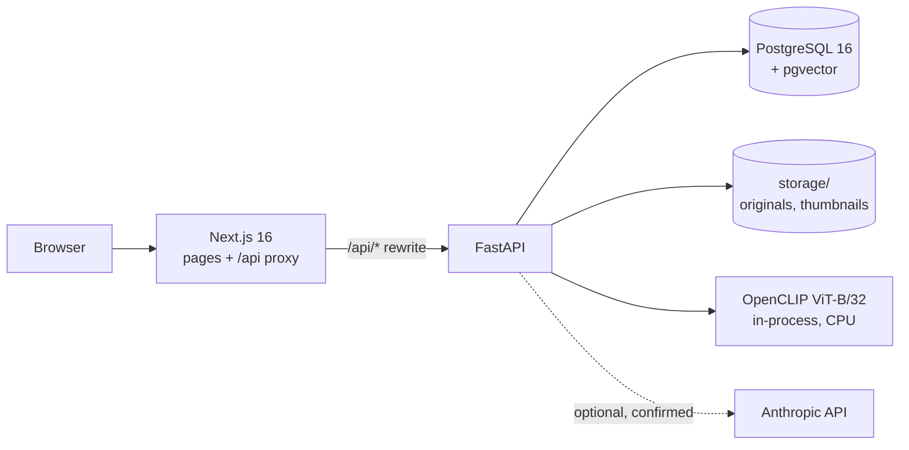
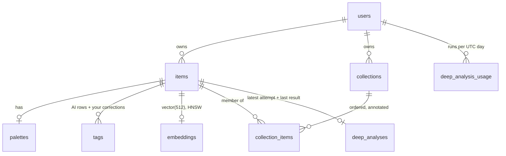
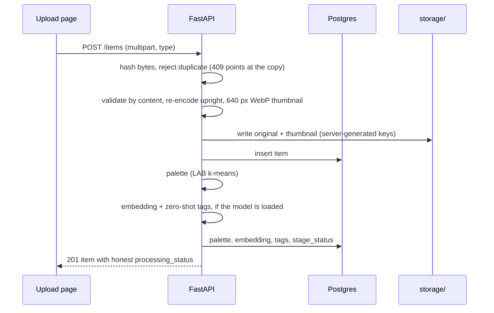

# Thread: architecture and algorithms

A walkthrough for explaining Thread in a technical interview. The [README](../README.md) is the
guide to setup and features; this document explains how the pieces work and why they were built
that way. Everything here describes the code as it is.

## In 30 seconds

Upload a photo of a garment or fabric. Within about a second Thread has validated it, measured
its colour palette in CIELAB, embedded it with a local OpenCLIP model, and tagged it zero-shot
(garment, pattern, fabric guess, Indian crafts). Click a similarity mode and pgvector finds the
nearest pieces in *your* library, each with the reason it matched. Search and filters, collections
and an optional Claude description sit on top. Everything runs locally; nothing leaves the machine
unless you confirm a deep analysis.

## System



- **One origin.** The browser only talks to Next.js; `/api/*` is rewritten to FastAPI. No CORS,
  and private images are only ever served by the API after an ownership check.
- **The model lives in the API process**, loaded once (under a lock) and reused. A background
  thread warms it at start-up; requests never wait for a load. While it loads, model-dependent
  endpoints answer `503 model_loading` and the UI retries.
- **No worker queue.** Palette, embedding and tags run inside the upload request (~1.2 s for a
  12 MP photo on CPU). Deep analysis, which takes tens of seconds, runs after the response in a
  thread. A real queue is the first thing to add for scale (see Trade-offs).

## Data model



- Every row is owned. Repositories filter by `user_id` in every query, and where two owned things
  meet (a collection and an item, an item and its deep analysis) **composite foreign keys**
  `(item_id, user_id)` make the database itself reject cross-owner links.
- `items.stage_status` (JSONB) records each analysis stage (`palette`, `embedding`, `tags`) as
  completed / failed / pending / unavailable; `processing_status` is derived from it, so the UI's
  "partly analysed" is a fact, not a guess.
- Tags keep AI predictions and your corrections in separate rows (`source = ai | user`,
  `user_action = add | remove`). "Visible tags" = AI tags you have not removed + tags you added.
  Re-analysis replaces AI rows only, so corrections survive.

## Request flows

### Upload



Each stage is best-effort on top of a safely stored upload: if the palette fails, the item says so
and no colours are shown; if the model is missing, the palette still appears and the item is
"partly analysed". Nothing is faked.

### Similar pieces (visual mode)

1. Index the query item if needed, then backfill up to 50 of your unindexed items (so a model
   installed after uploads catches up on first use).
2. Re-read the query vector by id and owner (the item may have been deleted mid-request; then 404).
3. `ORDER BY embedding <=> :query LIMIT 12` on the HNSW index, with the owner filter in the same
   query and `hnsw.iterative_scan` so filtering does not starve the results; re-sort by exact distance.

### Deep analysis

```mermaid
sequenceDiagram
  participant P as Item page
  participant A as FastAPI
  participant D as Postgres
  participant C as Claude
  P->>P: confirmation (what is sent, cost, daily guard)
  P->>A: POST /items/{id}/deep-analyze {"confirm": true}
  A->>D: advisory lock: one run per item, 2 in flight, 25/day; claim run_id
  A-->>P: 202 running
  A->>A: background: resize to 2576 px, sRGB, strip metadata
  A->>C: image + palette names + visible tags (marked "may be wrong")
  C-->>A: JSON constrained to a schema
  A->>A: check stop_reason, then validate (lengths too)
  A->>D: write only if this run is still current and the item exists
  P->>A: poll GET /items/{id}/deep-analysis every 2 s
```

## Algorithms

### Colour palette (CIELAB k-means)

1. Downscale to 256 px with nearest-neighbour sampling (averaging would invent blended edge colours).
2. For photos, a cheap plain-backdrop mask: if 85% of the border is one colour, keep pixels at
   CIEDE2000 >= 12 from it (only if the subject covers 5-95% of the image).
3. Convert sRGB to CIELAB (D65), where equal distances look roughly equally different, and run
   k-means (k = 6 by default, fixed seed) on up to 20,000 sampled pixels.
4. Merge clusters closer than CIEDE2000 6, drop clusters under 1%, round shares with the
   largest-remainder method so they sum to 100.
5. Convert centroids back to sRGB; the hex, RGB and stored LAB all describe that final colour.

Names: nearest reference colour by CIEDE2000 among 949 xkcd survey names plus a curated Indian
vocabulary (haldi yellow, sindoor red, neel indigo...). Families come from LCh lightness, chroma
and hue ranges. Harmony (monochromatic, analogous, complementary, mixed, neutral) is a labelled
heuristic over hue spreads in LCh.

### Image embeddings (OpenCLIP)

ViT-B/32 (`laion2b_s34b_b79k`), pinned by SHA-256 and loaded from local weights. Preprocessing is
fixed ("pp1": resize, centre-crop 224, CLIP mean/std), output is L2-normalised, so cosine
similarity is a dot product and pgvector's `<=>` is 1 - similarity. The embedder checks the
model's output size (512) against the database column when it loads.

### Zero-shot tags

Each label's phrases go through three prompt templates; a label's text vector is the normalised
mean, cached on disk under a key of model + template version + vocabulary hash (so a change can
never reuse stale vectors). The stored image embedding is compared with every label in a
category, `softmax(100 x cosine)` gives relative scores, and a label is stored only if it clears
the category's minimum and beats the runner-up by a margin ("none of these" wins means nothing is
stored). Scores are labelled relative and uncalibrated; thresholds were set by reasoning, not
fitted, because there is no labelled data.

### Similarity modes

- **Visual**: cosine similarity of embeddings (above).
- **Same palette, different silhouette**: a symmetric, share-weighted CIEDE2000 palette distance
  (each colour matched to the nearest colour of the other palette); pieces sharing the
  silhouette/garment tag are excluded only when both have one. Needs no model.
- **Same fabric, different colour**: the 100 nearest visual neighbours that share a fabric,
  pattern or craft tag, with a different dominant colour family first.

### Search

`ILIKE` (with `%`, `_` and `\` escaped) over visible tags, colour names and families, type, notes
and source URL; filters combine with AND. "Visible tags" is the same rule as the tags panel,
written once in Python and once in SQL, with a test that checks they agree on random cases.
Relevance is a transparent weighted score (exact tag 8, partial tag 4, colour or type 3, notes or
URL 1) and every result says why it matched. Filters live in the URL.

## Reliability

- **Partial success is a state, not an error** (`partially_completed`), and no stage discards
  another's work.
- **Model failures degrade, never break**: missing weights, a loading model or similarity turned
  off each produce a specific message; palettes, uploads, search and collections keep working.
- **Concurrent deletes**: writes that race a delete (indexing, tagging, deep-analysis results) go
  through a small guard that turns "the row vanished" into a 404 instead of a 500; other
  integrity errors still surface. Regression tests reproduce the races with real commits.
- **Clear failures**: an unreachable database is a `503 database_unavailable`, an unreachable API
  is named as such by the proxy-aware client, unknown pages have a styled 404, and render errors
  have an error page with retry.

## Security and privacy

Content-based upload validation and re-encoding; server-generated storage keys; owner checks in
every query plus composite foreign keys; private image responses with `nosniff` and a sandboxing
CSP; page-level CSP and related headers; secrets only in `.env`; the Anthropic client isolated
from machine-wide `ANTHROPIC_*` variables, profiles and proxies. The development user is refused
in production. Images and analysis stay local except a confirmed deep analysis.

## Testing strategy

- **Backend (pytest)**: each session creates a disposable database from the real Alembic
  migrations; each test runs in a rolled-back transaction. A fake embedder makes ML tests fast and
  deterministic; tests marked `ml` use the real model. Concurrency races use committed data and a
  second connection, because a rolled-back transaction cannot show them. The Claude client is
  tested through the real SDK against a mock HTTP transport, never the network.
- **Frontend (Vitest + Testing Library)**: components against a routed `fetch` mock, including
  error and retry states and URL-driven filters.
- **End to end (Playwright, desktop and mobile)**: the definition-of-done journey through the real
  stack, collections, deep analysis with a local fake, and a quality test for security headers,
  CSP violations, automated WCAG 2.2 AA checks (axe) and keyboard focus.

## Trade-offs and what I would do next

| Decision | Why | Cost / next step |
|---|---|---|
| Analysis inside the upload request | Simple, immediate results for a personal library | A worker queue (e.g. a Postgres-backed job table) for bulk imports and restart-safe deep analysis |
| One in-process model | One download, no GPU, no service to run | ~1 GB RAM per API process; a separate inference service if the API scales out |
| Zero-shot tags with reasoned thresholds | No labelled data exists | Collect corrections as labels and measure precision per category |
| `ILIKE` search | Correct and fast enough at personal scale (20-65 ms at 1,000 pieces) | Full-text search with weighted tsvectors beyond tens of thousands |
| CSP with inline scripts | Keeps pages statically rendered | Nonce-based CSP if the app is ever exposed |
| Single development user | Ownership is modelled and enforced end to end | Real authentication before any deployment |

## Questions you may be asked

- **Why CIELAB for k-means?** RGB distances do not match perception; in LAB, clusters group
  colours the way people see them, and CIEDE2000 gives a perceptual merge threshold.
- **Why one CLIP model for both search and tags?** The image embedding serves similarity directly,
  and zero-shot tagging only needs text vectors compared against that same embedding, so tagging
  costs ~20 ms after embedding and needs no second image pass.
- **How do you keep other users' items out of similarity?** The owner filter is in the vector
  query itself, and `iterative_scan` keeps the approximate index scanning when the filter removes
  candidates.
- **How do corrections survive re-analysis?** They are separate rows; re-analysis only replaces
  `source = ai` rows, and the visible-tag rule combines them.
- **What happens if the model is missing or still loading?** Uploads and palettes work, the item
  is marked partly analysed, the UI explains what is missing, and a later similarity request
  backfills embeddings once the model is there.
